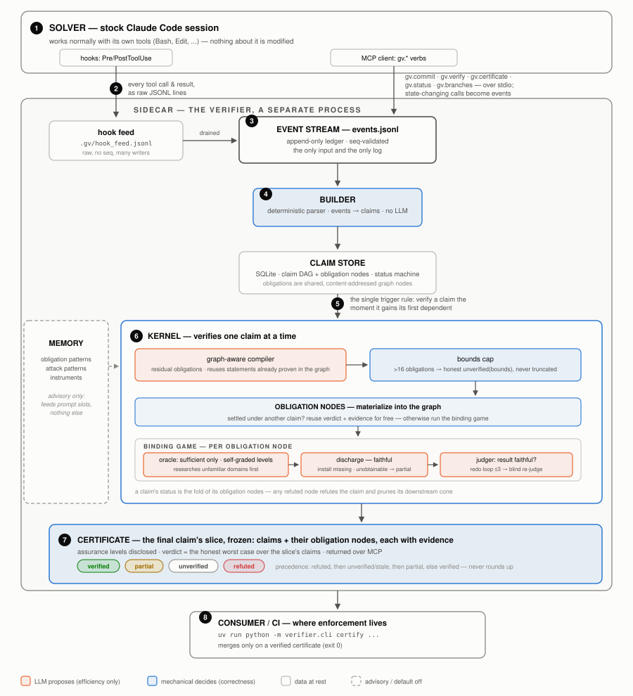

<h1 align="center">General Verifier</h1>

<p align="center">
  <a href="https://hemlix.me/General-Verifier/"></a>
  <a href="pyproject.toml"></a>
  <a href="https://hemlix.me/General-Verifier/runtime.html#model-backends"></a>
  <a href="LICENSE"></a>
</p>

<h3 align="center">Test-time verification for LLM agents: check the work, not the story</h3>

<p align="center">
  <a href="docs/architecture.svg"></a>
</p>

An LLM agent that ends its run with "Done, the answer is saved" has made a claim, not produced evidence. The tool log can show a successful write while the file holds the wrong value, and a grader that reads the transcript inherits every mistake the agent made along the way. As agents take on longer tasks, the cost of trusting that final message grows with them.

General Verifier (GV) verifies the result instead of the report. It reads the original task, the recorded tool calls, the final response, and the delivered files. From the task statement alone it compiles a contract of conditions that must hold, has a critic attack that contract for gaps, then establishes each condition with real tools: recomputing answers, inspecting delivered files, replaying records. A second model audits every piece of evidence, and mechanical gates in the kernel reject evidence that breaks a rule no matter how persuasive the model's argument. The output is a certificate: a verdict of `verified`, `supported`, `partial`, `unverified`, or `refuted`, with every check linked to the evidence and witness behind it.

GV runs offline on captured runs of Claude Code or Codex, and interactively as an MCP server that verifies each claim as the agent commits it. Use it to evaluate agents without a golden answer, to select among best-of-N candidates at test time, to gate CI on a certificate rather than a self-report, or to score agentic benchmarks with an inspectable trail instead of a single judge score.

## How it works

Follow one run through the figure above. The agent was asked to sum the integers 1 through 5 and save the result to a file. Its log shows a successful write and its final message says "Wrote 15", but the delivered file contains `14`.

1. **Capture the run.** Recording hooks write every tool call and result to a feed while the agent works. The harness saves the task statement, the final response, and the delivered files beside it. No model is involved.
2. **Reconstruct the claims.** The feed becomes an append-only ledger, and each tool result becomes an *effect* claim that a recorded event happened. An extractor rebuilds the assertions the final answer rests on, ending in one *final* claim: "answer.txt contains 15 followed by a newline."
3. **Compile the contract.** For the final claim, a compiler derives obligations from the task statement only, and a critic tries to construct a world where every obligation holds yet the task is not done, or where the task is done yet an obligation fails. Here the contract needs two conditions: the file holds the sum of 1 through 5, and it is a base-10 integer followed by a newline. A contract that only asks for "an integer" would let `14` pass, and the critic's job is to say so.
4. **Establish evidence.** For each obligation an oracle proposes methods, an executor runs the strongest one with tools, and a judger audits whether the method was sufficient and faithfully executed. Recomputing the sum and reading the captured file gives `15 ≠ 14`. Before the judger sees it, the kernel checks that the refutation came from a decisive method, rests on a positive observation, and did not use the agent's own output as its authority.
5. **Certify.** Obligation outcomes fold into the final claim's status, which is the verdict: `refuted`, with the witness `14`, the expected `15`, and the artifacts of the check. The successful log entry and the confident final message changed nothing, because neither counts as evidence about the world.

Two rules make this hold up. **Models judge meaning; code enforces types.** A model decides whether a method is sufficient, but code decides that a refutation from a weak method cannot count, that absence is not proof, and that record-level evidence cannot settle a claim about the world. **The final verdict does not trust the agent.** Intermediate claims are verified conditionally on their premises and reported that way, while the final contract is compiled with those premises withheld and checked against captured inputs. Every rule, gate, and budget is described in the [documentation](https://hemlix.me/General-Verifier/).

## Installation

GV needs Python 3.12 or newer, [uv](https://docs.astral.sh/uv/), and a model backend.

```bash
git clone https://github.com/sunyxedu/General-Verifier.git
cd General-Verifier
uv sync
cp .env.example .env    # then set DEEPSEEK_API_KEY, or configure another provider
```

The default backend runs verifier roles through the Claude Agent SDK against the provider in `.env`. If you have an authenticated Codex CLI on your `PATH`, skip `.env` and pass `--seats codex` to the commands below.

## Quickstart

Score the bundled example, a hand-written capture of the run in the figure with the correct answer delivered:

```bash
RUN_DIR="$(mktemp -d)"
cp -R examples/sum/. "$RUN_DIR/"
uv run python -m verifier.cli score --state-dir "$RUN_DIR"
```

Scoring calls the model backend and executes verification commands, so it takes a few minutes. It prints a summary, saves it as `score.json`, and exits `0` only for `verified`:

```json
{"verdict": "verified", "verdict_strength": "decisive", "certificate_id": "<sha256>"}
```

The certificate at `artifacts/<certificate_id>.json` lists every claim, its obligations, and the evidence that settled each one. Change the captured answer to `14` and score again to see a refutation with its witness.

To verify your own runs, save each attempt in its own directory and score it the same way. The [capture guide](https://hemlix.me/General-Verifier/capture.html) explains the layout and how to collect Claude Code or Codex sessions; a manifest maps the task's paths onto the captured files so nothing is checked against the wrong machine.

```text
run/
├── task.md               the original task, including output requirements
├── hook_feed.jsonl       recorded tool calls and results
├── final.txt             the agent's final response
├── world_manifest.json   which paths were captured
└── world/                the delivered files
```

To verify while the agent works, mount the MCP server from your project directory. The agent gets four verbs (`commit`, `verify`, `status`, `certificate`), each commit returns its verdict with the failing obligation and counterexample, and the [interactive guide](https://hemlix.me/General-Verifier/interactive.html) covers the protocol:

```bash
GV_REPO="$(pwd)"                       # run inside General-Verifier
cd /path/to/your/project
uv run --project "$GV_REPO" python "$GV_REPO/gv_tui.py"
```

## Why General Verifier?

- **Evidence, not opinion.** Checks are executed with tools and audited; a certificate can be followed from verdict to obligation to witness to artifact. A judge model's score cannot.
- **The agent cannot verify itself.** Independence, witness, basis, and strength rules are enforced in code, so a delivered artifact never serves as its own authority and a confident narrative earns nothing.
- **Sound reuse.** Claims, obligations, evidence, and artifacts are content-addressed. Shared checks run once, revisions invalidate exactly the evidence that depended on them, and interrupted runs resume without mixing configurations.
- **No task-specific prompts.** The model roles are told eight domain-free rules about evidence; everything about the task arrives at run time from the task statement and the captured environment.

## When not to use it

- **You have a mechanical oracle.** If a hidden test suite or exact answer already decides correctness, run that; GV is for tasks where success must be derived from the task statement.
- **The run was not captured.** Without the task statement, the trace, and the delivered files, there is nothing independent to check, and GV will say so rather than guess.
- **You need a probability.** Verdicts are an ordering with explicit ties, backed by evidence; they are not calibrated confidence scores.

## Evaluation

The [experiments](experiments/README.md) directory runs the same four-way comparison on Terminal-Bench 2.1, SWE-bench Pro, and the public FrontierMath sample: stock Claude Code, stock Codex, Claude Code with the LLM-as-a-Verifier plugin, and Claude Code with General Verifier mounted. Every benchmark is scored by its official harness; GV additionally reports certificate verdicts, so the headline safety number is the count of false certificates, runs that were `verified` and wrong. Regression tests (`uv run pytest -q`) cover the kernel's rules with fixture-backed roles; live-model accuracy is an empirical question the harness exists to answer.

## Documentation

The [documentation site](https://hemlix.me/General-Verifier/) opens with the architecture and then covers each part: [claims](https://hemlix.me/General-Verifier/claims.html), [task contracts](https://hemlix.me/General-Verifier/contracts.html), [evidence](https://hemlix.me/General-Verifier/evidence.html), [verdicts and certificates](https://hemlix.me/General-Verifier/verdicts.html), the [eight axioms](https://hemlix.me/General-Verifier/roles.html), and the [internals](https://hemlix.me/General-Verifier/reuse.html) that keep reuse and revision sound. The [reference](https://hemlix.me/General-Verifier/reference.html) lists every command, variable, file, and field, and [scope and limitations](https://hemlix.me/General-Verifier/limitations.html) states what a certificate can and cannot establish.

## Citation

```bibtex
@software{general_verifier_2026,
  author = {hemlix},
  title  = {General Verifier: Test-time verification for LLM agents},
  year   = {2026},
  url    = {https://github.com/sunyxedu/General-Verifier}
}
```

## License

General Verifier is released under the [Apache License 2.0](LICENSE). The documentation site bundles third-party theme and font assets under their own licenses, listed in [docs/report/assets/licenses/NOTICE.txt](docs/report/assets/licenses/NOTICE.txt).
