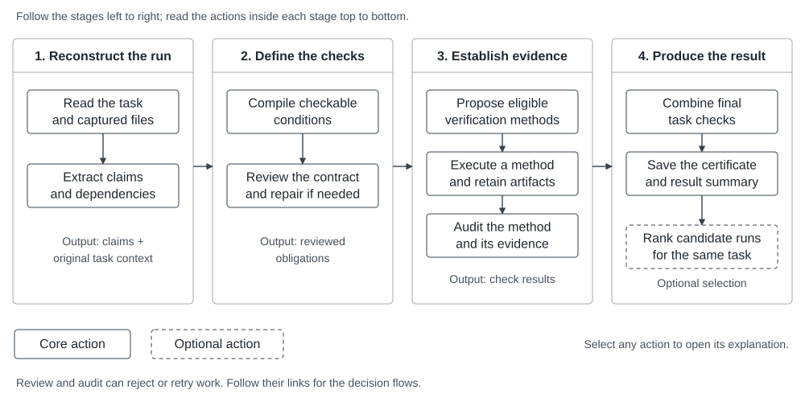

# General Verifier

## 摘要

一个代理说“任务已经完成”，与它实际交付了正确结果，是两个不同的事实。General Verifier（GV）围绕这一区别构建：接收任务、工具调用记录、最终回答和捕获的交付物，将待验证的声明拆成检查条件，选择并执行验证方法，再保存带有证据引用的证书。系统的主要工作流在代理结束后进行，也提供通过 MCP 接收实时声明的交互模式。

本报告的核心观点是：**通用验证器不仅需要生成检查，还需要在拆解、执行、复用和恢复执行的整个过程中保留检查的适用条件。** GV 用声明图记录依赖，用两条独立维度区分证据的来源与强度，并把未解决的检查、受限支持和决定性反例分开呈现。程序能够执行结构、状态和声明字段之间的一致性约束；任务解释、条件充分性以及证据的语义审查仍由模型承担。

本报告依据一个明确的代码快照和确定性回归测试描述现有实现，同时讨论 `clause`、`refutable_by_absence` 等设计的适用范围。当前证据支持“这些已知软件行为受到测试约束”，不支持“模型不会误判”或“已经获得跨领域性能提升”。因此，本文定位为**系统设计与实现报告**，并给出可以检验通用性、选择质量和验证成本的实验方案。

从实现角度，本文集中解释三个相互连接的设计：**将任务解释与证据接受分开**，让模型提出的检查受到明确规则约束；**将中间论证与最终交付分开判断**，避免一段可信叙述直接变成成功证明；**让复用结果保留原有条件**，使前提、来源、强度和输入版本不会在缓存或继承中丢失。

### Abstract

General Verifier (GV) checks completed agent runs by compiling claims into obligations, proposing verification methods, executing those methods, auditing the resulting evidence, and retaining an inspectable certificate. The primary workflow is offline; an interactive MCP interface shares the same verification engine. The system separates evidence basis from evidence strength, distinguishes conditional intermediate claims from independently checked final claims, and tracks the assumptions and input identities required for evidence reuse.

This report describes the implementation at an identified source revision. It separates mechanically enforced contracts from model-dependent semantic judgments, documents deterministic regression evidence, and examines unresolved abstractions such as source-clause attribution and absence-based refutation. It does not claim formal soundness, benchmark superiority, or a measured zero false-positive rate. Its contribution is a concrete architecture for preserving evidence conditions throughout agent verification, together with an evaluation protocol for testing that architecture.

## 1. 问题定义：究竟在验证什么

### 1.1 三个容易被混在一起的问题

考虑任务：“计算 1 到 5 的整数和，并把结果写入 `/app/answer.txt`。”代理执行了一个命令，随后回答“已经写入 15”。至少有三个问题需要分别回答：

| 问题 | 需要的证据 | 单凭它还不能说明什么 |
|---|---|---|
| 代理是否发起了那次命令？ | 保留的调用记录 | 命令是否产生了正确的最终结果 |
| 当时工具返回了什么？ | 与调用关联的工具结果 | 工具或代理报告的内容是否真实、最终文件是否后来改变 |
| 最终交付物是否满足任务？ | 原任务和捕获的文件，以及独立计算 | 未被捕获的状态或额外未审查的任务条件 |

正确的任务检查应从任务计算 `1 + 2 + 3 + 4 + 5 = 15`，再读取该次运行捕获的答案文件进行比较。如果文件里是 `14`，日志中的成功消息不能把它变成正确结果。反过来，某段中间解释错误，也不必然说明最终交付文件错误。

### 1.2 输入、输出与责任边界

把一个待评估运行记为 `R = (T, B, L, Y, W, M)`：`T` 是原任务，`B` 是必要的运行前输入，`L` 是工具事件记录，`Y` 是最终回答，`W` 是捕获的交付物，`M` 描述捕获范围和地址映射。某些分量可以缺失；缺失会限制能成立的检查。

GV 输出一个证书和一组评分特征。证书保留最终判断、相关声明、具体检查、证据引用和未解决事项。评分特征供多个候选运行之间的排序使用。这里的“证书”指**可追溯的验证记录**，不是经过逻辑证明内核检查的形式化证明。

本报告讨论 GV 如何对给定记录做判断。任务与捕获物是否来自真实运行、外部服务是否完整保存、模型是否正确理解自然语言，不能仅由本地哈希或 JSON schema 保证。

## 2. 系统结构与两种运行方式



*图 1：离线验证从一次已经完成的运行开始。模型负责解释与审查，程序负责执行显式契约和保存记录。最终证书之后，才进行跨候选选择。*

主要路径为：

```text
任务 + 记录 + 回答 + 交付物
    → 事件入库 → 提取声明图 → 编译与审查检查条件
    → 方法选择 → 执行 → 证据审查
    → 条件与状态检查 → 证书 → 可选的候选排序
```

**离线模式**使用 `verifier.offline.score()`。代理已经结束，验证结论不返回给原代理，适合在同一批固定候选上比较不同选择方法。提取器只接收结构性错误作为重试反馈，例如依赖无法解析、没有最终声明；验证结果不进入这条提取重试路径。

**交互模式**由 `Service` 通过 MCP 提供 `commit`、`verify`、`status`、`certificate`。代理提交声明并获得检查反馈，可以据此修订结果。它改变了后续生成过程，因此不能把交互式改进与固定候选集上的离线选择混为同一实验。

两个入口共用图存储、验证内核和证书逻辑。`replay` 则只从事件重建声明结构：它本身不会调用模型，也不会在一个空存储中恢复旧证书的验证状态。

实现依据：[离线入口](../../verifier/offline.py)、[MCP 服务](../../verifier/mcp_server.py)、[事件构建器](../../verifier/stream/builder.py)。

## 3. 数据模型：把声明、检查和证据分开

### 3.1 声明不是工具结果

声明有三种公开类型：`assertion` 表示中间结论，`effect` 表示工具事件的记录引用，`final` 表示最终结果声明。依赖边指出当前声明建立在哪些此前声明之上。

`effect` 的确定性检查核对的是事件身份和保留的记录。它不证明工具报告中的业务事实为真。比如，核对“日志确实记录了工具输出 15”，仍不同于独立证明正确答案为 15。

普通声明的内容身份由种类、文本和依赖确定；显式 `revises` 也进入修订后的身份。同样文字可以在修复交付物后产生新的验证版本，重复提交同一版本则继续去重。事件日志保留提交历史，SQLite 保存当前的物化状态。

### 3.2 检查条件的契约

声明的检查条件称为 obligation。当前模型包含以下字段：

| 字段 | 在现有实现中的作用 | 判断来源 |
|---|---|---|
| `text` | 独立可理解的待检查命题 | Compiler 生成、Critic 审查 |
| `required_basis` | 接受证据的最低来源要求：`record` 或 `world` | 模型声明，程序检查匹配 |
| `severity` | `must` 的反例可反驳声明；`should` 的违反降低结果 | 模型解释任务语气，程序聚合 |
| `clause` | 保留检查对应的任务或声明原文 | 模型引用，供审查和追溯 |
| `refutable_by_absence` | 是否允许缺失类见证用于反驳 | 模型分类，程序执行布尔门槛 |
| `premise_scope` | 这项检查允许假定哪些前提 | 内核根据依赖范围设置 |

`severity`、`clause` 和缺失标记在模型输出 schema 中可省略，内核分别使用 `must`、空字符串和 `false` 作为缺省值。Prompt 对这些字段提出了更强的说明要求；“schema 接受”与“语义完整”不能等同。

检查节点可以被多个声明使用。其内容身份包含文本、证据来源要求、缺失反例规则和前提范围。`severity`、`clause` 保存在声明到检查的关系上：同一检查事实可以在不同声明中承担不同角色。

### 3.3 保留证据，不让工作目录替代证据

执行器返回结果与见证，并保存执行产物的内容寻址快照。证据记录还可以携带使用过的输入、输入来源、桥接假设和假定前提。持久工作目录帮助复用构建工具、解析结果或证明工程；工作目录里的文件本身不自动授予可复用的已验证结论。

快照有容量上限和工具链目录排除规则，因此它并不等于整个执行环境的完整归档。哈希标识保存的内容，不能证明没保存的内容，也不是数字签名。

实现依据：[数据契约](../../verifier/core/model.py)、[状态存储](../../verifier/core/store.py)、[执行与快照](../../verifier/execution/discharge.py)、[产物存储](../../verifier/execution/instruments.py)。

## 4. 从任务到检查：必要性与充分性

### 4.1 中间声明的条件检查

对于中间声明 `c`，允许使用的前提集合为 `P`。检查条件应该覆盖“假设 P 成立后，还需要建立什么，才能接受 c”。这包括结论本身和必要的推理缺口，不能只重复代理此前声称做过的事情。

对强制条件集合 `O_must`，可以用两个逻辑方向理解审查目标：

```text
必要性：P ∧ c ⇒ oᵢ          对每个强制条件 oᵢ
充分性：P ∧ (∧ O_must) ⇒ c
```

这些公式描述系统希望模型审查的关系；实现没有把自然语言自动翻译成某种逻辑并证明这些蕴涵。建议条件 `O_should` 额外影响结果质量，不应被冒充为任务完成不可缺少的条件。

### 4.2 Critic 挑战的是分解本身

Critic 检查两类错误：是否存在任务已完成却被额外检查错误拒绝的情况；是否存在所有检查都成立、任务仍未完成的情况。分解可以在有限轮次中修复。默认 critic 轮数为 4；用尽预算而未获得可接受分解时，系统留下失败记录。

审查必须覆盖完整契约。仅看到检查文本而看不到 `severity` 或缺失规则，会让 Critic 审查的条件与程序实际执行的条件不一致。当前实现把完整模型输出送入审查历史，并对“只追加”的修复比较已有条件的完整属性，防止追加新检查时顺带降低原有要求。

### 4.3 最终声明的独立性

最终声明不使用中间结论作为假设。Compiler 获得任务上下文，而显式的依赖假设列表和声明图上下文被隐藏；最终检查的允许前提范围为空。没有 `task.md` 时，最终声明自身的文字成为可用契约，这种运行不能声称审查了一个未提供的完整原任务。

这里的“独立”首先是**验证契约层面的独立**。角色仍有读取工具和上下文访问能力；隐藏某段 prompt 不是对所有其他文件的访问隔离，也不证明模型统计意义上的独立性。

实现依据：[Compiler 与 Critic 调度](../../verifier/engine/kernel.py)、[条件生成提示](../../verifier/llm/prompts/obligations.py)、[审查提示](../../verifier/llm/prompts/critic.py)。

## 5. 方法、执行和证据审查

### 5.1 方法契约先于执行

每个检查由 oracle 列出候选方法，包括操作过程、预期产物、证据来源和强度。执行器按照所选方法开展检查，judger 再审查方法是否足够、是否忠实执行，以及采用较弱方法是否有正当理由。

如果执行偏离方法，judger 的理由可以触发重做。重做反馈单独传递，不应被悄悄改写为新的方法契约。结构性不可执行、运行失败和获得反例也是不同结果：它们不能相互替代。

### 5.2 证据来源与证据强度是两个维度

| 维度 | 值 | 语义 |
|---|---|---|
| 来源 `basis` | `record` | 保留记录证明当时记录了什么 |
| 来源 `basis` | `world` | 检查捕获对象，或从任务输入独立计算所需事实 |
| 强度 `strength` | `decisive` | 声明的方法或证书足以决定目标命题 |
| 强度 `strength` | `bounded` | 在更窄范围建立结果，通过显式桥接假设关联目标 |
| 强度 `strength` | `analytic` | 基于固定产物的分析性支持，强度较弱 |

对工具记录的精确身份检查可以同时是 `record` 和 `decisive`：它精确决定“这条记录是否匹配”，但不能因此证明记录中的业务结论。对真实交付代码运行少量测试，则可以是 `world` 和 `bounded`。

`world` 不是“正确”的同义词；`decisive` 也不是模型置信度。二者都是需要审查的声明。程序会检查来源是否满足条件要求，但不知道一个实际操作是否真的配得上所声明的来源和强度。

### 5.3 强度下降不是失败后的自动通行证

绑定过程优先尝试较强方法。采用较弱方法需要记录更强候选在当前证据和工具条件下的不可用性，并通过降级审查。普通崩溃、重试失败或一个不利发现，不能直接成为改用弱方法并宣布成功的理由。

这种检查只约束**被列出的候选方法及其审查记录**。它不证明已经穷尽所有更强方法；oracle 可能没有想到某种仪器。这是计算可用性与模型搜索能力共同形成的边界。

内核只接受达到决定性强度的反驳。较弱方法得到的不利结果保留为信号，而不是自动升级为决定性反例。原始结果 `holds`、`refuted`、`failed`、`unobtainable` 再经过这些规则后才进入状态聚合。

实现依据：[绑定过程](../../verifier/engine/game.py)、[角色与 schema](../../verifier/llm/agents.py)、[Judger 提示](../../verifier/llm/prompts/judger.py)。

## 6. 条件结论、最终证书与候选排序


*图 2：中间结论的局部通过不能消除前提缺口。最终声明拥有单独的任务检查，因此中间推理失败既不能替它证明正确，也不能直接决定交付物错误。*

### 6.1 局部状态和有效状态

存储中的局部状态回答“在允许的前提下，这个检查结果如何”。读取时计算的有效状态还考虑整个前提链。中间声明的局部通过可以与有效未验证同时存在；证书分别披露二者。

来源和强度也随可依赖的前提链折叠。依赖仅由记录或较弱方法支持的前提，不能通过跨声明继承变成不受限制的决定性结论。局部反例同样受这个限制。

当前实现还将被反驳的前提链向下标为有效 `refuted`。这是一条**拒绝依赖已失败论证链的状态策略**，不能解释成经典逻辑中的 `¬P ⇒ ¬c`。下游命题可能通过别的方法成立。最终声明不使用这条前提折叠作为最终判定。

### 6.2 五种证书结果

| 结果 | 当前含义 |
|---|---|
| `verified` | 最终编译出的检查均成立，强度为决定性，且至少有一项 `world` 来源检查 |
| `supported` | 检查均成立，至少有一项 `world` 检查，但最终证据中存在较弱强度 |
| `partial` | 存在结构性不可用检查或建议条件违反；其余检查均成立，且没有被接受的强制条件反例 |
| `unverified` | 检查失败或尚未解决，或最终只建立了记录层面的支持 |
| `refuted` | 强制条件存在被接受的决定性反例 |

最终判断并不是简单统计整张图的成功比例。其他声明及其证据保留在证书里，但最终 verdict 由最终声明自己的检查状态给出。`supported` 是证书层对较弱证据的呈现，不是 ClaimStore 中单独的持久状态。

聚合时，已接受的强制反例优先决定 `refuted`。没有这类反例时，运行失败或未解决的检查会阻止结果成为 `partial`：系统将其留在 `unverified`，而不把一次失败当作已确定的结构性不可用。

“至少一项 world 检查”是一条当前策略，不是任务正确性的定理。一个只要求完成可观察动作的过程任务可能合理地依赖记录；这条策略仍可能让它停在 `unverified`。同时，一项无关的 world 检查也不能在语义上弥补错误的分解。

`unscoreable` 是独立的评分失败标记，例如提取失败或输入封存失效，不能与有反例的 `refuted` 混为一谈。CLI 只在 `verified` 时返回退出码 0。

### 6.3 排序表达的是偏好顺序

当前选择键为：

```text
rank(R) = (verdict_band, -final_contrary_signals)

verified > supported > partial > unverified > refuted > unscoreable
```

第二项只计算最终契约中被违反的建议条件，越少越好。已通过检查的数量、通过比例和叙述长度不参与排序。这样避免仅靠拆出更多容易通过的检查获得更高排名，但建议条件如何拆分仍可能改变违反计数，并非对所有分解方式都不变。

同键候选是显式平局。`argmax_set` 返回全部最高候选；需要单一结果时，`argmax` 稳定选择第一个。排序键和供投票使用的标量都不是经过校准的正确率概率。`refuted` 排在 `unverified` 后面，也属于选择政策，需要用任务数据验证其效果。

实现依据：[有效状态](../../verifier/core/store.py)、[证书](../../verifier/engine/certificate.py)、[特征与排序键](../../verifier/offline.py)、[选择函数](../../verifier/selection.py)。

## 7. 复用、修订与恢复执行

### 7.1 复用必须携带适用条件

系统有两种结果复用：相同检查节点的直接复用，以及从同文声明继承已建立的结果。前者由包含前提范围的内容身份约束；后者检查来源声明的有效状态、证据来源、强度和反例适用规则。

`假设 P，得到 Q` 不能仅因另一处也出现 Q 就转化为 `Q 已独立建立`。一个由“缺失”得到的反例，也不能转移到不允许这种反驳方式的契约。核对状态时必须同时核对产生状态的证据，不能把旧通过状态与新失败记录配在一起。

### 7.2 显式修订使旧证据失效

代理可能修复文件，而不改变“文件现在正确”这句话。`revises` 因此进入声明身份：修订创建新版本，普通重复提交继续去重。

修订会传播到声明依赖、它的检查节点、共享这些检查的其他声明，以及当前证据中记录的继承消费者。历史产物仍保留，但当前状态转为过期，重新建立后才可再次使用。旧数据库的修订身份有一次性迁移处理；重启回放本身不应反复触发同一版本的检查。

这种传播依赖显式修订和已记录的关系。它不是对任意外部世界变化的自动探测器。在线任务改变了此前声明描述的状态时，调用方仍需提交相应修订。

### 7.3 恢复缓存也是证据问题

离线评分把任务、基线、轨迹、最终文本、交付物和捕获清单纳入输入身份。`extract.json` 与 `verification.json` 分别记录提取和物化判断对应的输入、代码与配置；后者还绑定相关来源事件。

SDK 配置身份包含实际模型、服务商、端点指纹和文本模式。Codex 配置还区分推理强度和服务层级。端点以指纹形式记录，避免公开记录直接携带可能嵌入 URL 的凭据。相同别名背后的远端模型权重仍可能变化，配置身份不等于完整模型快照。

普通离线目录输入变化后，不兼容的派生判断会重建；由适配器先行封存的输入发生变化时，评分会拒绝继续接受该运行。评分前后的内容检查可以发现持久改变，但不能证明过程中从未短暂修改过输入。符号链接的指纹也不意味着它指向的外部状态已被完整冻结。

实现依据：[修订身份](../../verifier/core/model.py)、[失效传播](../../verifier/core/store.py)、[缓存与输入封存](../../verifier/offline.py)。

## 8. “General”应该如何理解和检验

### 8.1 跨领域接口不等于已证明的通用能力

GV 的接口没有要求任务必须是某一种文件格式、编程语言或 benchmark。它可以表达任务、命题、依赖、方法和证据。捕获世界也使用地址映射，而不把所有对象都直接等同于验证机器的绝对路径。

但接口能表达一个任务，不代表模型能正确拆解它、找到足够的方法，或者在当前环境中执行这些方法。通用性至少有三层：**表达范围、验证工具的可达性、跨领域判断的可靠性**。三者需要分别评价。

仓库中的 prompt 通用性测试检查领域词、导出结构和文本预算。这可以抑制显眼的针对性规则增长，但不能检验“没有具体名词的规则是否仍过拟合了少数案例”。

### 8.2 `clause`：来源记录的价值和局限

`clause` 让审查者追问“这项条件为什么是要求”，有助于识别模型额外制造的限制。这种追溯需求具有跨领域用途。

当前字段要求引用原文，但一个派生检查可能来自多条条件共同作用、任务引用的标准，或者从目标命题推出的必要条件。程序并未证明引用与检查之间的蕴涵。若把“找到一句原文”当作完整依据，就可能把审查简化成文字匹配。

一个值得实验检验的方向，是将直接引用、引用的语义权威和派生理由区分记录。这是对现有抽象的研究建议，不是本报告所描述代码已经实现的功能。是否有收益，应比较多余检查率、遗漏率和审查成本。

### 8.3 `refutable_by_absence`：目标通用，布尔表达有限

“没有找到证明”与“证明不存在”不同。当前字段试图阻止前者冒充反例。它与 `witness_kind` 配合，允许在声明为存在要求的条件上使用缺失类见证。

问题在于，缺失证据是否充分还取决于搜索完整性、覆盖范围和时间。例如有限集合上的穷尽判定，与截断日志里的未出现，不能只依据共同的“没找到”措辞分类。当前程序执行的是见证类别与布尔标记的匹配；捕获完整性及类别的语义正确性仍需要模型审查。

因此，不能因为引入这个字段就宣布避免了所有缺失型误判；也不能仅凭它没有领域名词就宣布抽象完全通用。更根本的问题是：**已保留的证据，在明确范围内，是否足以推出目标条件为假？** 后续应测试分类一致性，以及改变见证表述是否会改变判定。

### 8.4 其他需要公开承认的策略

`must/should` 的划分、只允许决定性反驳、最终至少包含一次 world 检查、建议违反计数打破平局，都是现有设计选择。其中有明确的保护动机，但没有一条可以仅靠 schema 证明适合全部任务。

尤其要把自然语言里的“必须”“建议”和任务实际接受条件结合理解，避免将语气分类变成粗糙关键词规则。程序可以确保一个已声明的 `must` 不被偷偷改成 `should`；它不能单凭该字段证明最初的分类正确。

依据：[八项证据原则](../../verifier/llm/prompts/criteria/axioms.py)、[字段生成要求](../../verifier/llm/prompts/obligations.py)、[见证门槛](../../verifier/core/model.py)、[通用性测试](../../tests/test_prompt_generality.py)。

## 9. 已有验证证据：软件行为，不是模型准确率

本报告对应的实现快照通过了 **469 项 pytest 测试**。命令、时间、实现版本和输入文件指纹记录在随报告发布的 [validation.json](validation.json) 中。数字描述该快照的测试结果，不是覆盖率，也不代表 469 个独立真实任务。

多数模型角色由固定响应替代，从而将目标软件行为与模型随机性分开。部分用例实际读取文件、执行计算或模拟子进程故障；这些测试不能据此证明真实模型会生成同样充分的检查。

| 回归主题 | 被检验的行为 | 代表性测试 |
|---|---|---|
| 完整审查契约 | Critic 获得字段；追加修复不能修改旧要求 | [test_critic.py](../../tests/test_critic.py) |
| 最终独立性 | 最终不接受假定前提；普通声明不能冒充最终证书 | [test_certificate_fold.py](../../tests/test_certificate_fold.py) |
| 条件证据复用 | 不同前提范围不能共享无条件结果 | [test_evidence_reuse.py](../../tests/test_evidence_reuse.py) |
| 反例来源与强度 | 反例继承保留前提限制，不能借其他检查升级 | [test_evidence_reuse.py](../../tests/test_evidence_reuse.py) |
| 修订与历史 | 文件由对变错、由错变对后重新检查；同文修订和重启可用 | [test_revisions.py](../../tests/test_revisions.py) |
| 输入与配置变化 | 不兼容缓存失效，来源事件得以保留 | [test_offline.py](../../tests/test_offline.py) |
| 失败输出 | 失败进程或上次残留 JSON 不能构成新成功 | [test_codex_backend.py](../../tests/test_codex_backend.py) |
| 证据边界 | 捕获范围、封存和输入改变的处理 | [test_candidate_seal.py](../../tests/test_candidate_seal.py) |
| 使用入口 | 无关凭据不阻止帮助、回放和后端选择 | [test_cli.py](../../tests/test_cli.py) |

这里特别值得区分两类结论：回归用例可以证明一个具体反例在当前程序中不再按旧路径错误通过；它不能排除不同输入、不同执行顺序或模型误标导致的其他错误。数值性能结论需要独立的任务数据与评估设计。

## 10. 如何做有说服力的实验

仓库包含 FrontierMath、SWE-bench Pro 和 Terminal-Bench 的实验入口，但**本报告没有将未核对版本和来源的运行目录整理成性能榜单**。以下是建议的评估设计，尚不是实验结果。

### 10.1 先固定候选，再比较选择器

针对每个任务生成固定的候选集合。原任务、记录、交付物、候选顺序和运行标识在所有离线选择器间保持一致。比较随机或首选基线、普通模型评分、现有 LLM-as-a-Verifier 基线和 GV；交互式 GV 单独作为会改变生成过程的实验组。

正确性标签来自与 GV 判断独立的任务评估。标签及其奖励文件应在验证结束前对角色隐藏，并在适配器层检查实际可见的捕获内容。结果分析同时包含所有失败和 unscoreable 运行，避免只报告成功评分的子集。

### 10.2 同时衡量准确性、弃权和成本

| 指标 | 回答的问题 |
|---|---|
| 被标为 verified 的结果中有多少错误 | 最强结论的实际可信程度 |
| 在正确候选中有多少得到 verified / supported | 验证能力是否过度保守 |
| unverified、partial、unscoreable 的比例与原因 | 缺口来自模型、工具、捕获还是运行故障 |
| 固定候选集上的选择成功率与完整平局集合 | 选择器是否有效区分候选 |
| 每个任务的调用数、token、费用和墙钟时间 | 收益是否值得验证成本 |
| 相同候选多次评分的变动 | 判断与分解的稳定性 |

对比例报告分母与置信区间；对同任务多候选的比较，应按任务进行配对或重采样。出现零个错误时，也要报告样本规模和不确定性，不能写成“错误率为零”的普遍保证。

### 10.3 用消融检验机制，不只比较总分

优先检验六个问题：独立最终契约是否减少遗漏；Critic 是否改善必要性和充分性；执行证据相对仅阅读记录带来什么变化；来源与强度门槛怎样影响误判与弃权；复用与缓存能否降低成本而保持结果；缺失规则及 `clause` 是否在新领域减少误判而非制造新限制。

测试通用性时，应冻结 prompt 和判定政策，在未据其错误调过规则的领域上评估。增加复述、无关成功记录、等价任务表达、截断证据和候选顺序变化等扰动，可以检验验证器究竟依赖任务结果还是叙述形式。

实验入口：[实验说明](../../experiments/README.md)、[Terminal-Bench 评分器](../../experiments/terminal_bench/score_official.py)。

## 11. 可信边界与已知局限

| 边界 | 程序实际能检查什么 | 仍未由程序保证什么 |
|---|---|---|
| 结构化输出 | 字段类型、枚举和部分关系 | 文本内容正确、条件充分 |
| 输入来源声明 | 拒绝已声明为交付物的权威来源等组合 | 来源是否被正确申报、是否漏报 |
| 事件与产物哈希 | 保存内容的一致性与引用身份 | 记录最初真实、捕获完整或发布者身份 |
| 方法审查 | 必要字段、审查结果及受约束的重试流程 | 审查模型的语义判断正确 |
| 多角色分工 | 不同角色收到的显式任务和接口 | 错误互不相关、模型之间相互独立 |
| 工作空间与封存 | 指定输入的前后指纹及后端权限配置 | 所有执行都处于完整、统一的安全隔离环境 |
| 结果恢复 | 已记录输入和配置对应的状态失效 | 外部服务和同名远端模型完全不变 |

GV 的默认 SDK 角色可执行工具；离线 Codex 使用单独的权限配置，允许在指定工作目录写入，并保留网络能力用于工具安装。这些实现不能被概括成对不可信任务代码的通用安全沙箱。角色也可能受到任务、产物或外部内容中的指令影响；schema 验证不会消除语义层的提示注入。

证书保存证据引用，但通过图继承得到的支持可能还需要沿来源声明、数据库和产物继续追踪。单个证书 JSON 并不保证包含完整运行环境、所有依赖和全部原始字节。复核时应同时保存状态目录及必要捕获物，或进一步设计可独立携带的证据包。

当前最重要的研究工作，是测量这些边界造成的实际误判、弃权和费用，再决定哪些声明式字段应该被更强的可核查记录替代。增加更多字段或 prompt 规则本身并不等于可靠性提升。

## 12. 复现一条完整路径

先按仓库 [README](../../README.md) 安装依赖并配置模型后端。以下命令使用已有的合成捕获示例，不需要生成代理重新运行任务：

```bash
uv sync
RUN_DIR="$(mktemp -d)"
cp -R examples/sum/. "$RUN_DIR/"
uv run python -m verifier.cli score --state-dir "$RUN_DIR"
```

使用已认证 Codex CLI 时，将最后一行替换为：

```bash
uv run python -m verifier.cli score --state-dir "$RUN_DIR" --seats codex
```

查看 `score.json` 中的 `certificate_id`，即可读取 `artifacts/<certificate_id>.json`。同时检查最终声明的 obligations、各自 evidence、来源和强度，不要只读取顶层 verdict。然后在一个新的示例副本中将 `world/app/answer.txt` 改成 `14`，观察独立计算检查是否能给出合适反例。

真实模型可能失败、生成不充分方法或给出错误判断；这个示例提供输入和审计路径，不保证每次调用都得到某个固定 verdict。确定性回归验证使用：

```bash
uv run pytest -q
```

若要复核本文测试快照，先检出页首标注的实现版本，再运行该命令。较新的文档构建测试或代码变更可能使主分支的测试数量变化。

## 13. 与相关工作的关系

**LLM-as-a-Verifier** 使用评分 token 的概率分布构造连续分数，并研究评分粒度、重复评估和条件分解等维度。它与 GV 都关心如何选择更好的候选，但输出结构和方法约束不同：GV 额外组织执行方法、声明依赖、证据条件及证书。这个差异构成比较问题，不能直接推出哪一个效果更好。[论文](https://arxiv.org/abs/2607.05391)

**Agent-as-a-Judge** 将具备代理能力的系统用于代理评估，包括更细粒度的任务要求和中间反馈。因此，“使用代理评估代理”并非 GV 独有的概念。GV 在本报告中的关注点是证据条件在拆解、复用、修订和恢复中的保留，而不是声称首次引入会执行工具的评估者。[论文](https://arxiv.org/abs/2410.10934)

**Proof-Carrying Code** 展示了生产者提供证明、消费者检查证明以接受程序的思路。GV 的可审计记录与这种“结果携带依据”的组织方式有相似之处，但其自然语言拆解和语义审查并没有被小型形式化证明检查器替代。本文不将 GV 的 certificate 等同于形式化证明证书。[原论文中的方法说明](https://www.usenix.org/legacy/publications/library/proceedings/osdi96/full_papers/necula/html/node2.html)

## 14. 结语

General Verifier 把一次代理结果的评估组织成明确的检查条件、方法执行、审查记录与证据引用。其工程价值在于让结果的适用条件能够被保留、追踪和作废，并让未解决的工作有明确位置。当前实现仍是一个模型参与语义判断的验证系统。要进一步确立其研究价值，需要在固定候选、独立标签和受控费用下，证明这些机制确实改善了跨领域的误判、弃权或选择质量。

## 附录：阅读实现的最短路径

| 想核对的问题 | 建议阅读 |
|---|---|
| 一次离线评分如何开始与恢复 | [offline.py](../../verifier/offline.py) 的 `score`、`config_fields` |
| 检查怎样被编译、复用和聚合 | [kernel.py](../../verifier/engine/kernel.py) 的 `_compile_obligations`、`_settle_one`、`_settle` |
| 方法为什么被接受或拒绝 | [game.py](../../verifier/engine/game.py) 的 `BindingGame.run` |
| 当前结论依赖什么 | [store.py](../../verifier/core/store.py) 的 `effective`、`_mark_stale_cone` |
| 证书究竟包含什么 | [certificate.py](../../verifier/engine/certificate.py) 的 `request_certificate` |
| 字段是否通用、哪里依赖模型解释 | [model.py](../../verifier/core/model.py)、[agents.py](../../verifier/llm/agents.py)、[证据原则](../../verifier/llm/prompts/criteria/axioms.py) |
| 交付物地址怎样映射 | [world.py](../../verifier/core/world.py) 的 `WorldView` |

网页版中的实现链接固定到报告审查的代码版本；Markdown 源文件中的相对链接遵循 GitHub 当前浏览版本。实验建议和抽象改进建议均已明确标注，不应当作现有功能或已完成实验。
