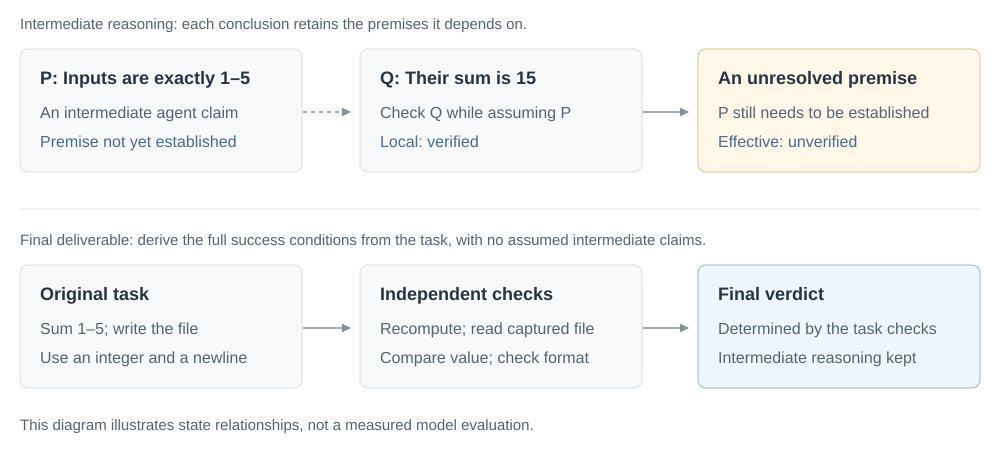

# General Verifier

General Verifier (GV) checks whether an AI agent's result satisfies its task. It turns the requirements into checks, executes verification methods, and records the evidence behind its verdict.

For installation and backend configuration, see the [repository README](../../README.md). To run a small example and inspect its result, start with [Getting started](#getting-started).

## How verification works

The workflow has four stages. For an explanation of the steps, see [Verification workflow](#verification-workflow), or select an action in the diagram.


*[Contract review](#review-and-repair) and [evidence audit](#execution-and-audit) describe the review and retry loops within these stages.*

### Reconstruct the task context

GV reads the original task, tool records, final answer, and captured files. It extracts claims and their dependencies while keeping the original inputs available for verification. See the [input example](#the-task-and-captured-run) and [objects in the claim graph](#five-objects-to-inspect).

### Review the task requirements

The Compiler proposes checks, and the Critic reviews whether they cover the claim without imposing extra requirements. A rejected contract must be repaired and reviewed before verification proceeds. See [Task contracts](#task-contracts).

### Execute and audit verification methods

GV executes methods against records, captured deliverables, or task inputs. It then audits whether the method can establish the condition and whether execution followed that method. See [Evidence and audit](#evidence-and-audit) for acceptance, retry, and rejection decisions.

### Inspect the verdict and evidence

The final verdict comes from checks of the original task and delivered result. The certificate retains their evidence and unresolved issues. See [Independent final checks](#independent-final-checks) for the design rule and [Reading the results](#reading-the-results) for interpreting a certificate.

## Using General Verifier

The [offline scorer](#offline-and-interactive-verification) checks a completed run. The same verification kernel is available through an interactive MCP service, where an agent can submit claims, receive feedback, and revise its work.

For several runs of the same task, [candidate selection](#rank-several-candidates) compares verdicts and violations of advisory conditions. Ties remain explicit; the ranking is not a probability of correctness.

## Design and implementation

[Implementation](#implementation) explains evidence reuse, revision invalidation, concurrent checks, resumption, and artifact storage.

[Scope and limitations](#scope-and-limitations) describes what a certificate can establish and the assumptions it depends on. [Evaluation](#evaluation) sets out how to measure reliability and cost. The [code reading guide and related work](#code-and-references) provide further detail.

## Getting started

This example shows the files GV reads, how to run verification, and where to inspect the result. It uses a small arithmetic task so that the expected answer and every output requirement are easy to check.

### The task and captured run

The repository includes a hand-written run in [examples/sum](../../examples/sum/task.md). Its task is:

> Compute the sum of the integers from 1 through 5, inclusive, and save it to `/app/answer.txt` as a base-10 integer followed by a newline.

The captured run has this structure:

```text
examples/sum/
├── task.md                 Original task, including output format
├── hook_feed.jsonl         Tool calls and their recorded results
├── final.txt               The agent's final answer
├── world_manifest.json     Capture scope and path mapping
└── world/app/answer.txt     Delivered file: 15 followed by a newline
```

The task's `/app/answer.txt` refers to a file from that run. During offline verification, GV uses the capture manifest to map it to `world/app/answer.txt`. A file at the same absolute path on the verifier's machine cannot substitute for the captured deliverable.

This example needs no files from before the run: all inputs to the sum are in the task. More complex tasks can also supply a `baseline/` directory containing original inputs that the agent has not modified.

### Run the check and find the result

Follow the repository [README](../../README.md) to install dependencies and configure a model backend. Then copy and score the example:

```bash
uv sync
RUN_DIR="$(mktemp -d)"
cp -R examples/sum/. "$RUN_DIR/"
uv run python -m verifier.cli score --state-dir "$RUN_DIR"
```

For an authenticated Codex CLI, add `--seats codex` to the last command. Scoring invokes models and can execute verification commands.

After the run, `score.json` contains the result summary. Its `certificate_id` points to `artifacts/<certificate_id>.json`, which lists the final claim, checks, evidence, and unresolved issues:

```text
score.json                            Verdict and ranking features
    └── certificate_id
          └── artifacts/<id>.json     Checks and evidence references
```

### Check what was delivered

For this task, the final checks need to cover at least two requirements:

1. A delivered file exists at the specified location and uses the required integer-and-newline format.
2. Its value matches the result independently calculated from the original task.

The second check recomputes `1 + 2 + 3 + 4 + 5 = 15` and compares that value with the file. A recorded message saying that the write succeeded can help locate an event, but cannot supply the expected answer for this comparison.

The table below illustrates the decision rules. It does not report a measured model run:

| Captured file | Finding | Implication for task completion |
|---|---|---|
| `15` followed by a newline | Value and format match the task | Both requirements are supported |
| `14` followed by a newline | Value conflicts with the independently computed 15 | A concrete witness refutes completion |
| `15` without a newline | Value is correct; the explicit format requirement fails | The task is not fully complete |
| File cannot be read; capture scope is unclear | The original file's state cannot be determined | Evidence is missing; file absence has not been established |

GV generates its checks using models, so an actual run may decompose the task differently. The example gives us a standard for evaluating that decomposition: **the checks should cover what the task requires, and each conclusion should be traceable to its evidence.**

## Verification workflow

GV reconstructs a run, defines its checks, establishes evidence, and produces a result. The [overview diagram](#how-verification-works) shows the whole path; this page explains the responsibilities of each stage. [Getting started](#getting-started) follows these stages with a small arithmetic task.

### Reconstruct the run

 Input preparation identifies the original task, tool records, final answer, and captured files, including any gaps in the capture. The Extractor then reconstructs claims and their dependencies. In the sum example, “a file-write command ran,” “the sum is 15,” and “the task is complete” are different claims. Extraction retries address structural problems such as unresolved dependencies or a missing final claim. Offline verdicts are not fed back to the Extractor to rewrite the history.

### Define the checks

 The Compiler turns a claim into checkable conditions. The Critic reviews the complete contract, including which conditions are mandatory. For the sum, the checks must cover both the expected value and the required file format. A rejected contract goes back for repair within a fixed budget. If no acceptable contract emerges, the claim remains unverified. [Contract review](#task-contracts) explains this loop.

### Establish evidence

 For each obligation, the Oracle proposes methods, the Executor runs an eligible method and retains its artifacts, and the Judger audits the result. An accepted result settles that check. Rejected attempts may lead to a redo or a different method; exhausted search retains a failure or an availability gap. [Execution and audit](#evidence-and-audit) explains these branches. Compatible established evidence can also be [reused](#include-scope-in-shared-check-identities), avoiding a new execution.

### Produce the result

 The kernel combines the final claim's own checks into a verdict. The certificate retains those checks, their evidence, and the relevant intermediate reasoning; `score.json` contains the summary. When several runs solve the same task, the optional selector ranks their results. [Reading the results](#reading-the-results) explains the verdicts and how to inspect their basis.

Models interpret the meaning of tasks and evidence; code enforces the declared constraints. For example, a model assesses whether a method is sufficient, while the program enforces whether a method declared to provide weak evidence may refute a claim. The semantic assessment can still be wrong even when the program correctly enforces its rules.

### Five objects to inspect

| Object | What it records | Example |
|---|---|---|
| `claim` | A proposition to assess, with its dependencies | “The delivered result satisfies the task” |
| `obligation` | A condition required to establish the proposition | “The file's value matches an independent calculation” |
| `method` | A procedure intended to establish the condition | Recompute the sum, read the file, compare values |
| `evidence` | Execution results, witnesses, artifacts, and premises used | The calculation produced 15; the file contained 14; both observations are recorded |
| `certificate` | The final verdict and the relevant checks | Which condition failed, why, and what remains unresolved |

Claims have three kinds: an `assertion` is an intermediate conclusion, an `effect` refers to a tool event, and a `final` states the final result. A deterministic check of an `effect` verifies event identity and retained records. Confirming that a log contains 15 does not, by itself, establish that 15 is the correct answer.

These objects help locate the source of a failure: task interpretation, insufficient checks, failed execution, or evidence containing a counterexample. They also let a reader inspect those distinctions after a verdict has been produced.

### Offline and interactive verification

The main entry point is offline [`score()`](../../verifier/offline.py#L615). The original agent has finished, and GV scores a fixed record of its run. The agent receives no verification feedback, allowing different selectors to be compared on the same candidates.

The interactive [MCP service](../../verifier/mcp_server.py) exposes `commit`, `verify`, `status`, and `certificate`. An agent can submit claims, receive feedback, and revise its deliverables. Because feedback changes subsequent generation, interactive improvement and offline candidate selection need separate evaluations.

Both entry points share the graph store, verification kernel, and certificate logic. `replay` has a narrower responsibility: reconstructing claim structure from events. Replaying into an empty store does not recreate the verified status of evidence that is no longer present.

## Task contracts

The task contract defines the conditions that must hold for a claim to be accepted. The Compiler proposes these conditions, and the Critic reviews whether they match the task.

### Cover the task requirements

Even a perfectly reliable executor will reach the wrong verdict if it is given the wrong checks. Consider the [example task](#getting-started): save the sum of 1 through 5 to `/app/answer.txt` as an integer followed by a newline.

- Checking only that the file contains an integer is insufficient: `14` would pass.
- Requiring a loop to compute the sum adds a restriction the task never imposed.

The Compiler and Critic therefore review the mandatory checks in both directions: **completing the task should satisfy the checks, and satisfying all the checks should establish the target claim.** The first direction avoids unnecessary requirements; the second avoids missing requirements.

### Review and repair

In the sum example, a proposed check that only requires an integer would accept `14`. That is a useful counterexample for the Critic: it exposes a missing value requirement. The Compiler can repair the proposal, but the repaired contract must pass review before its checks are used.


*Contract review for a final claim. A diamond asks a question; each outgoing arrow names the answer. Repair returns to review, and budget exhaustion stops acceptance.*

### Necessity and sufficiency

For an intermediate claim `c`, permitted premises `P`, and mandatory conditions `O`, these review goals can be written as:

```text
Necessity:   P ∧ c  ⇒  each mandatory condition o
Sufficiency: P ∧ O  ⇒  c
```

These formulas express the review goals. The current implementation asks models to assess relationships expressed in natural language; it does not discharge them through a formal proof kernel.

### Preserve the full contract

The Critic must see the complete check contract, including required evidence, mandatory or advisory severity, and whether an absence witness may refute the condition. Otherwise, a repair could quietly turn a mandatory condition into an advisory one without changing its text. Repairs that only append checks are also constrained: they may add conditions but may not alter existing contracts. The default review budget is four rounds. If no acceptable decomposition emerges, the system retains a failure record.

Implementation: [`_compile_obligations()`](../../verifier/engine/kernel.py#L441) and the [Critic prompt](../../verifier/llm/prompts/critic.py).

## Evidence and audit

GV checks both how evidence was obtained and what it can establish. A method must meet the obligation's requirements, and its execution must survive an audit before its result can be accepted.

### Evidence source

First consider the source. In the [sum example](#getting-started), reading a tool result that says “the answer is 15” establishes what the record contains. Recomputing the answer from the task and reading the captured file checks the task result independently. GV distinguishes these through `basis`:

| Basis | Meaning | Example |
|---|---|---|
| `record` | Retained records establish what was recorded | The tool result contains “15” |
| `world` | Inspect a captured object or independently establish a fact from task inputs | Recompute the sum and inspect the delivered file |

From the repository root, this code illustrates the numerical comparison:

```python
from pathlib import Path

expected = sum(range(1, 6))
delivered = Path("examples/sum/world/app/answer.txt").read_text()
print(int(delivered) == expected)  # True
```

This snippet checks only the value; the required format needs its own check. GV's methods are proposed by models, rather than hard-coded to this sum.

Independence also depends on where the expected answer comes from. If the agent created an `expected.txt` file, comparing two files produced by that agent does not automatically establish correctness. Evidence can therefore declare the origin and role of each input. The kernel rejects an input declared to be an agent deliverable when it is used as an authority for correctness. Whether those origins are declared accurately and completely still needs review.

### Evidence strength

Now consider strength. Running ten tests against real code inspects the deliverable, but may not cover every input. GV uses `strength` to distinguish how a method supports its target:

| Strength | What the method claims to establish |
|---|---|
| `decisive` | Enough to decide the current obligation |
| `bounded` | A result over a narrower scope, connected to the target through explicit bridge assumptions |
| `analytic` | An analytical judgment based on fixed artifacts and identifiable witnesses |

Basis and strength answer different questions. An event-identity check can be `record + decisive`; a finite test suite can be `world + bounded`. These labels are method claims subject to audit, not model confidence scores.

The system tries stronger methods first. A weaker method becomes eligible only after the stronger listed tiers have been found structurally unavailable; omitted stronger tiers and the downgrade itself are reviewed by the Judger. A crash or an unfavorable result does not automatically justify moving to a weaker method.

### Execution and audit

Once an eligible method is selected, execution follows this path:


*Execution and audit for one candidate method. A result must pass both the kernel's evidence rules and the Judger's audit. The return arrow repeats execution of the same method; it does not redefine the obligation.*

The **kernel gates** check the declared basis, admissible witness, and input authority. They also enforce decisive-only refutation: adverse findings from weaker methods remain diagnostic signals. Execution failures and unavailable results are recorded without becoming accepted evidence.

The **Judger** then assesses substantive results, including proposed refutations. It checks whether the method can decide the obligation and whether execution actually followed that method against the right target. In the sum example, independently recomputing the sum is a suitable method, but reading an unrelated file on the verifier's machine would be an execution error. Such a deviation can trigger a redo of the same method. A procedure that merely compares two agent-authored answer files needs a different method, because its source of correctness is inadequate.

### Retries and unresolved checks

A redo retains the original method and the execution feedback, then submits the new artifacts for a fresh audit. The default limit is three redos. A failure to obtain a valid Judger response uses a separate audit retry; it does not authorize executing the method again.

Rejected candidates remain in the attempt record. An exhausted batch can request a bounded Oracle repair. For offline final obligations requiring `world` evidence, an empty repair can also trigger one focused search for a decisive counterexample. These searches only propose methods: any new method still has to execute and pass the same audit. If no candidate settles the check, the system retains a failure or a structural availability gap.

This process constrains the listed candidates and recorded execution. The Oracle may still miss a better method, and the Judger may misjudge sufficiency. Implementation: [`BindingGame.run()`](../../verifier/engine/game.py#L130).

## Independent final checks

GV retains the agent's intermediate reasoning, but the final verdict must be established from the original task and delivered result. This prevents an unchecked intermediate conclusion from becoming an assumption in the final check.

### Conditional intermediate claims

Intermediate conclusions are often conditional. Suppose the agent claims:

```text
P: The inputs to this sum are exactly 1, 2, 3, 4, and 5.
Q: Their sum is 15.
```

Assuming P, checking Q is straightforward. But until P has been established, this argument cannot be treated as a fully established fact. GV keeps two states:

- **Local state:** whether the claim's own checks pass under its permitted premises.
- **Effective state:** what other checks may rely on after accounting for the actual state of the premise chain.

Q may be locally verified while remaining effectively unverified. Basis and strength also retain limitations inherited from premises: a conclusion depending on weak evidence cannot become decisive merely by being reused.



*Intermediate reasoning retains its unresolved premises. Final checks return to the original task and captured deliverables. Both paths remain available in the certificate.*

### Return to the original task

A final claim has an empty set of permitted premises. The Compiler derives the complete success conditions from the original task. It cannot omit the numerical check because the agent previously claimed to have calculated the answer correctly. Established evidence may still be reused when it satisfies the current contract; unestablished intermediate conclusions cannot be assumed.

### An incorrect premise and a correct result

An incorrect intermediate explanation also need not invalidate a correct deliverable. The final result can be established independently. For intermediate reasoning, the current implementation propagates an effectively `refuted` state down a refuted premise chain to mark it as unusable. This is a dependency policy, not a logical proof that a false premise makes every downstream conclusion false. Final verdicts do not use that propagation policy to decide whether the deliverable is correct.

If `task.md` is absent, GV can construct a contract only from the final claim's own wording. It cannot claim to have checked an original task that was never supplied. Implementation: [`effective()`](../../verifier/core/store.py#L356) and [`request_certificate()`](../../verifier/engine/certificate.py#L44).

## Implementation

The rules for contracts and evidence must survive reuse, parallel execution, and resumption. Otherwise, conditions retained during one check can disappear the next time its result is used. Five mechanisms address this problem.

### Include scope in shared check identities

Two claims may require the same check. Repeating model and tool calls is expensive, so GV stores obligations as shared graph nodes with identifiers derived from their content.

The important question is what counts as the same check. Deduplicating by text alone would conflate “establish Q assuming P” with “establish Q independently.” The main contents of `Obligation.id` are:

```python
return content_hash({
    "schema": "gv-obligation-v2",
    "text": self.text,
    "required": self.required_basis,
    "refutable_by_absence": self.refutable_by_absence,
    "premise_scope": self.premise_scope,
})
```

Text, required evidence basis, absence rules, and permitted premise scope all affect whether evidence can be shared. A final check has an empty premise scope, so it does not share an identifier with an identically worded check that assumes P.

Two other fields belong to the relationship between a claim and its obligation: `severity` records whether the condition is mandatory or advisory, and `clause` records its source wording. The same fact may be mandatory in one task and advisory in another. Its factual check can be reused while each task keeps its own acceptance criteria.

Inheriting a result from an identically worded claim also requires checking the source's effective state, basis, strength, and whether any counterexample applies to the new condition. Reuse carries the result's applicability conditions along with its verdict.

Code: [`Obligation.id`](../../verifier/core/model.py#L242), [`_settle_one()`](../../verifier/engine/kernel.py#L329).

### Invalidate evidence after a revision

In the [sum example](#getting-started), suppose the file initially contains `14`. After fixing it to contain `15` and a newline, the agent may submit the same statement: “The answer file is correct.” If identity depended only on text and dependencies, the new submission would hit the old record and the repair would never receive a fresh check.

An explicit `revises` reference therefore participates in claim identity. Ordinary duplicate submissions still deduplicate. Revising a previous claim creates a new verification version even when the text is unchanged. Replaying the same revision event retains the same identifier.

Revision must also invalidate users of old evidence. Propagation currently follows three kinds of relationships:

1. Claim dependencies, such as Q relying on P.
2. Claims and their obligation nodes, including other claims sharing an obligation.
3. Inheritance recorded in current evidence, such as a result borrowed from another claim.

Affected states become `stale`; their basis and strength are cleared until rechecking. Historical evidence and artifacts remain available. Inheritance follows current evidence so that a new independent check is not invalidated by an obsolete historical source.

This mechanism relies on explicit revisions and recorded relationships. It does not automatically detect every external state change. Code: [`Claim.id`](../../verifier/core/model.py#L193), [`_mark_stale_cone()`](../../verifier/core/store.py#L258).

### Coordinate concurrent checks

Verification may call models, run tests, or install tools. Independent checks can run concurrently, but two claims may request the same shared node at the same time.

Within a Kernel instance, GV uses separate locks for claim identifiers and obligation identifiers. After acquiring a node's lock, a caller checks the stored state and decides whether to reuse or execute. A waiting caller then sees the completed result and avoids repeating the work. The lock covers the entire sequence from cache inspection through result storage.

Concurrency also affects when to stop. Once a mandatory condition has an accepted counterexample, checks that have not started are cancelled. Running checks finish and retain their records. Final aggregation preserves the witness, basis, and strength of the check that actually determined the refutation; a later, unrelated result must not overwrite that provenance.

Parallelism reduces waiting but may do work that becomes unnecessary after a counterexample arrives. These locks coordinate work within one process. They do not provide a distributed or cross-process exactly-once execution guarantee.

Code: [`_settle_obligations()`](../../verifier/engine/kernel.py#L273), [`_settle_one()`](../../verifier/engine/kernel.py#L329).

### Bind resumption to inputs and configuration

The previous run checked `15` followed by a newline; the file now contains `14`. Returning an existing `score.json` without checking its inputs could apply the old verdict to a new deliverable. Changes to the task, model, or verification code create the same problem.

Offline scoring records identity across three categories:

- **Inputs:** task, baseline, tool records, final answer, deliverables, and capture manifest.
- **Implementation and configuration:** verification code, resolved model, provider, endpoint fingerprint, and relevant runtime options.
- **Source events:** tool events and claim commits from which the verification state was materialized.

`extract.json` binds extraction results to their inputs and configuration. `verification.json` also binds verification state to relevant source events. Incompatible derived judgments must be rebuilt. Claims originally submitted through the interactive protocol are source data and must survive a verification-configuration change.

Captured candidates may also be sealed by an adapter. Changes to an ordinary offline directory can trigger rebuilding derived judgments. Changes to a sealed candidate cause rejection, preventing modified materials from being accepted as the original candidate.

Endpoints are recorded through fingerprints rather than raw URLs that might contain credentials. A remote model alias can still point to changing weights, so matching configuration does not make the entire model environment reproducible. Code: [`score()`](../../verifier/offline.py#L615).

### Retain inspectable artifacts

The Executor has temporary execution directories and can use a persistent workspace to reuse tools and intermediate files. After a check, GV saves execution results, witnesses, and artifact snapshots. Merely placing a conclusion in the workspace does not give it verified status.

`ArtifactStore` derives filenames from content. It writes a temporary file and atomically replaces the destination, so concurrent readers do not observe half-written JSON. Identical content can refer to the same artifact.

The retention scope matters. Text snapshots have file-count and content-size limits, mark truncation, and exclude some toolchain directories. They are not complete environment archives, and content hashes are not publisher signatures. Inherited evidence may require following source claims and database records. A review should therefore retain the state directory and necessary captured inputs, as well as the top-level certificate JSON.

Code: [`ArtifactStore.put()`](../../verifier/execution/instruments.py#L33), [execution and snapshots](../../verifier/execution/discharge.py).

## Reading the results

### Five verdicts

The final verdict is determined by the final claim's own checks. Intermediate reasoning remains in the certificate for inspection; the fraction of passing nodes across the whole graph does not decide deliverable correctness.

| Verdict | Meaning |
|---|---|
| `verified` | All final checks are established with decisive strength, including at least one with `world` basis |
| `supported` | All final checks are established, including at least one with `world` basis, but some strength is weaker |
| `partial` | Some checks are structurally unavailable or advisory conditions are violated; the remaining checks are established and there is no mandatory counterexample |
| `unverified` | Checks failed, remain unresolved, or establish only record-level support for the final result |
| `refuted` | A mandatory condition has an accepted decisive counterexample |

An accepted mandatory counterexample gives `refuted` priority. Without one, an execution failure does not qualify as `partial`: the system has not established whether the failure is temporary or the check is structurally unavailable under the capture. It remains `unverified`.

`unscoreable` is a separate scoring-failure flag, for example after extraction failure or an invalidated input seal. It does not establish a counterexample. The CLI returns exit code 0 only for `verified`.

### Follow the evidence in a certificate

To inspect a certificate:

1. Find the claim referenced by `final` and check that its conditions cover the original task, rather than merely repeating the final answer.
2. Inspect its `obligations` for failed, unavailable, or refuted conditions.
3. Follow `evidence` to the method, artifacts, and witnesses. Review any assumed premises or bridge assumptions too.
4. For intermediate claims, compare local and effective state, including `open_premises` and `premise_refuted`.

If the answer file contains `14`, a credible refutation should identify what was read, why the expected answer is 15, and how the comparison was performed. An opinion that the answer “looks wrong” does not supply that evidence chain.

### Rank several candidates

The selector ranks candidates by verdict band, then by the number of violated advisory conditions in the final contract:

```text
verified > supported > partial > unverified > refuted > unscoreable
Within a band: fewer violated final advisory conditions rank higher.
```

It uses neither pass counts nor pass ratios. Splitting one easy condition into ten does not improve a candidate's rank merely by adding passes. However, splitting advisory conditions may change the violation count, so ranking is not invariant to every decomposition.

Candidates with identical keys remain tied. `argmax_set` returns the entire best set; `argmax` stably selects the first when one answer is required. Neither the ranking key nor the scalar used for voting is a calibrated probability of correctness.

Code: [certificates](../../verifier/engine/certificate.py), [ranking features](../../verifier/offline.py), [selection](../../verifier/selection.py).

## Scope and limitations

### Three meanings of generality

GV expresses problems through tasks, claims, verification methods, and evidence. Its interface is not tied to one programming language or benchmark. Assessing generality still requires three separate questions:

- **Expressiveness:** can the interface accurately represent the task requirements, external standards, and dependencies?
- **Tool access:** do the captured inputs and execution environment permit the required verification method?
- **Judgment quality:** can models find sufficient checks and audit the evidence correctly in a new domain?

A general interface cannot recover an external service state that was never captured. Prompts without domain-specific terms can discourage obvious special cases, but do not demonstrate reliability in new domains.

### Trace a check to its source

`clause` records the task or claim wording behind an obligation. It helps answer “Where did this requirement come from?” and detect additions such as requiring a loop in the sum example.

A quotation does not establish a derivation. An obligation may follow from several sentences together, an external standard referenced by the task, or a necessary consequence of the goal. Even “the result is 15” requires a calculation: the original sum task does not provide that answer directly.

The field is therefore an inspectable source record, not a complete justification of the obligation. Separately recording direct quotations, authoritative sources, and derivation reasons is a possible design to evaluate. The current implementation does not provide that full representation.

### Decide when absence is evidence

The Boolean `refutable_by_absence` works with witness categories to control whether “not found” can refute a condition. If a task requires a file and a complete directory capture establishes that it is absent, absence may be a counterexample. A truncated log that never mentions the file only establishes a gap in the log.

The distinction depends on search scope, capture completeness, and time. The program currently matches an absence category against the Boolean flag; models must review the deeper semantics. Describing the same observation as `absence` or `execution` may also trigger different gates, making classification stability a relevant test.

The underlying problem applies broadly, but a Boolean is a coarse representation. Evaluation should determine whether the field reduces false verdicts, rejects valid counterexamples, or would benefit from more explicit records of search scope.

### Trust boundaries

Several boundaries affect how a certificate should be interpreted.

**Model judgments.** A schema checks structure, not the completeness of obligations, sufficiency of methods, or correctness of evidence categories. Final contracts receive no explicit intermediate premises, but this does not isolate every file access. Different roles may also use the same model, so their errors need not be independent. Instructions embedded in tasks and artifacts can still influence models.

**Capture and execution.** Before-and-after fingerprints can detect persistent changes, but cannot prove that no temporary mutation occurred during execution. A captured symbolic link does not freeze the external state it points to. SDK and Codex backends have different tool-permission configurations; the system does not provide one uniform sandbox policy.

**Acceptance policies.** Mandatory versus advisory conditions, decisive-only refutation, and requiring at least one `world` check for a fully accepted final result are current policy choices. A task that only requires an observable operation may reasonably rely on records, yet the all-record abstention rule may leave it `unverified`. These policies need evaluation against task data.

A GV certificate retains a judgment's task interpretation, checks, and evidence. Its semantic correctness still requires independent evaluation.

## Evaluation

Software regression tests check the program's rules for contracts, evidence, revisions, and resumption. They do not measure whether live models choose sufficient checks or interpret evidence correctly. The evaluation below is a proposed protocol for measuring those semantic judgments and their cost.

### How to evaluate the design

The repository has [experiment entry points](../../experiments/README.md) for FrontierMath, SWE-bench Pro, and Terminal-Bench. The presence of experiment code alone does not establish accuracy or a performance advantage.

First, fix the candidate runs for each task. Every offline selector should see the same tasks, records, and deliverables. Correctness labels should come from independent evaluation and remain hidden from verifier roles until verification ends. Interactive verification needs a separate experimental group because it changes generation.

### Measure reliability, coverage, and cost

Report three dimensions together: errors among the strongest verdicts, the share of correct candidates that receive support, and the calls, tokens, cost, and time required. Failures and `unscoreable` runs belong in the denominators. Candidate selection should also report success rate, tied sets, and variability across repeated scoring, so that one accuracy number does not hide excessive abstention or cost.

### Test the design choices

Ablations should test the contributions of independent final checks, the Critic, actual execution, basis and strength gates, reuse and caching, source quotations, and absence rules. Report denominators and confidence intervals for proportions, and use paired comparisons for the same tasks. Zero observed errors still requires a sample size and an uncertainty estimate.

### Test new domains and equivalent inputs

For generality, freeze prompts and verdict policies before testing domains not used to tune the rules. Task paraphrases, irrelevant success messages, truncated evidence, equivalent witness descriptions, and candidate-order changes can help reveal whether judgments depend on task facts or presentation.

## Code and references

### Code reading guide

| Question | Entry point |
|---|---|
| How does offline scoring start and resume? | [`offline.score`](../../verifier/offline.py#L615) |
| How does a task become checks? | [`Kernel._compile_obligations`](../../verifier/engine/kernel.py#L441) |
| How are methods executed and audited? | [`BindingGame.run`](../../verifier/engine/game.py#L130) |
| How do claims share a check result? | [`Kernel._settle_one`](../../verifier/engine/kernel.py#L329) |
| How do premises limit a usable conclusion? | [`ClaimStore.effective`](../../verifier/core/store.py#L356) |
| How do revisions invalidate old evidence? | [`ClaimStore._mark_stale_cone`](../../verifier/core/store.py#L258) |
| How are final checks combined? | [`Kernel._settle`](../../verifier/engine/kernel.py#L1267), [`request_certificate`](../../verifier/engine/certificate.py#L44) |
| How are captured paths resolved? | [`WorldView`](../../verifier/core/world.py) |

Code links open the implementation discussed on these pages.

### Related work

[LLM-as-a-Verifier](https://arxiv.org/abs/2607.05391) studies continuous scores derived from rating-token probability distributions, together with scoring granularity, repeated evaluation, and conditional decomposition. GV can also select among candidates, while additionally organizing execution methods, claim dependencies, evidence conditions, and certificates. A comparison requires the same candidates and cost constraints; structural differences alone do not establish a performance advantage.

[Agent-as-a-Judge](https://arxiv.org/abs/2410.10934) uses agentic systems for evaluation, including fine-grained requirements and intermediate feedback. Tool-using evaluation agents are not unique to GV. This report focuses on how evidence conditions survive decomposition, reuse, revision, and resumption.

[Proof-Carrying Code](https://www.usenix.org/legacy/publications/library/proceedings/osdi96/full_papers/necula/html/node2.html) has producers supply proofs that consumers check before accepting programs. GV retains supporting evidence, but models still participate in natural-language interpretation and semantic audit. Its certificate is not a formal proof certificate.
