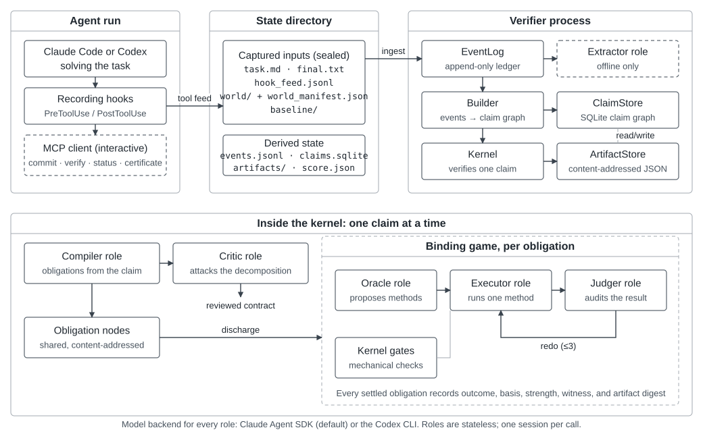
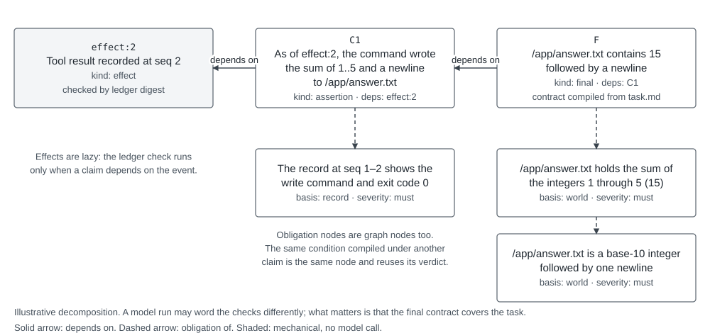
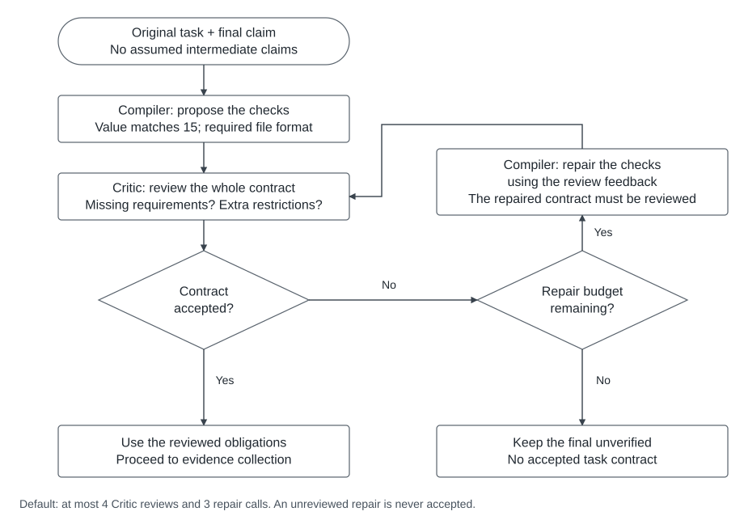
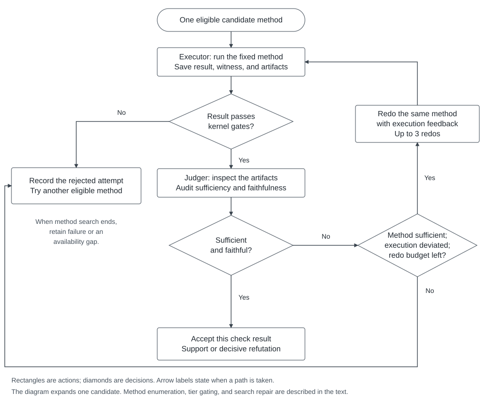
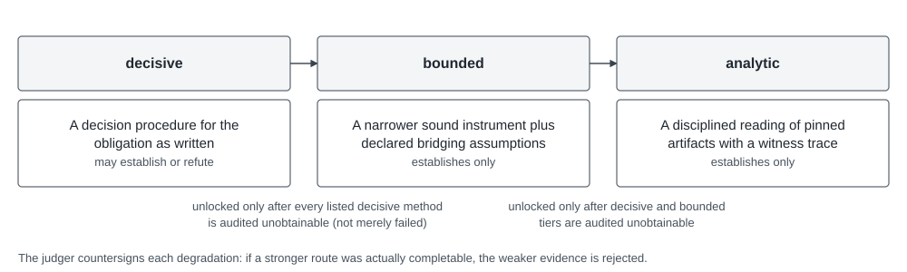
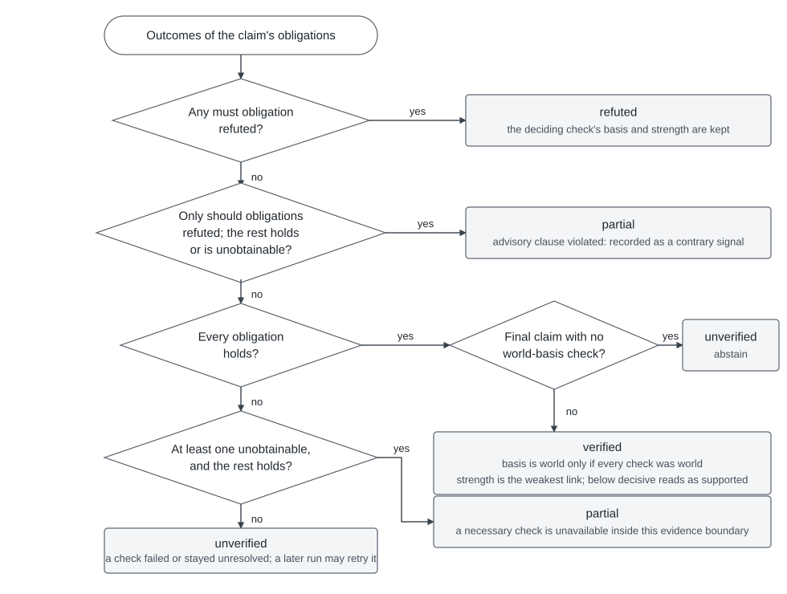

# General Verifier

General Verifier (GV) checks whether an AI agent actually completed its task. An agent that writes "Done, the answer is saved" has produced a report, not evidence. GV reads the original task, the recorded tool calls, the final response, and the delivered files. It then turns the task into concrete checks, runs those checks with tools, audits the results, and writes a certificate that links its verdict to the evidence behind it.

GV is a Python package. It has two entry points: an **offline scorer** that verifies a finished, captured run, and an **interactive MCP server** that verifies claims while an agent is still working. Both use the same verification kernel.

## How it works

Every run passes through five stages. Select an action in the diagram to open its explanation, or read the summaries below.


### 1. Capture the run

Recording hooks write every tool call and result to a feed file while the agent works. The harness saves the task statement, the agent's final response, and the delivered files next to it. Nothing here calls a model. See [Capturing agent runs](#capturing-agent-runs).

### 2. Reconstruct the claims

The feed becomes an append-only ledger. Each tool result becomes an *effect*, a claim that a recorded event happened. Offline, an extractor model reconstructs the assertions the final answer rests on and one *final* claim stating what was delivered. See [Claims and the claim graph](#claims-and-the-claim-graph).

### 3. Define the contract

For each claim, a compiler model proposes *obligations*: conditions that must hold for the claim to be true. A critic model attacks the proposal in both directions, looking for a missing condition and for a condition the task never required. For a final claim the contract comes from the task statement, never from the agent's own account. See [Task contracts](#task-contracts).

### 4. Establish evidence

For each obligation, an oracle model proposes verification methods, an executor agent runs the strongest available method with real tools, and a judger agent audits whether the method was sufficient and faithfully executed. Mechanical gates in the kernel reject evidence that breaks a rule, whatever a model says. See [Evidence](#evidence).

### 5. Decide

The kernel folds obligation outcomes into a claim status. The final claim's status is the verdict. The certificate keeps every claim, obligation, and piece of evidence so a reader can follow the reasoning. When several runs of one task exist, a ranking key compares their certificates. See [Verdicts and certificates](#verdicts-and-certificates).

## Two rules that shape everything

**Models judge meaning; code enforces types.** A model decides whether a method is sufficient. Code decides whether a "refuted" result from a weak method is allowed to count (it is not). Every rule that can be enforced mechanically lives in the kernel as a gate, so a persuasive but wrong model answer settles nothing.

**The final verdict does not trust the agent.** Intermediate claims are verified conditionally on their premises, and the certificate exposes that. The final claim's contract is compiled from the task statement with the agent's premises withheld, and it is verified against captured inputs and the delivered world. An agent that narrates confidently gains nothing.

## Where to start

| If you want to | Read |
|---|---|
| Run GV once and see a certificate | [Getting started](#getting-started) |
| Understand the design end to end | [Architecture](#architecture), then the Design pages in order |
| Verify your own Claude Code or Codex runs | [Capturing agent runs](#capturing-agent-runs) |
| Give an agent verification feedback while it works | [Interactive verification](#interactive-verification) |
| Understand reuse, revision, concurrency, and resumption | [Identity, reuse, and revision](#identity-reuse-and-revision) and [Execution, resumption, and backends](#execution-resumption-and-backends) |
| Look up a flag, file, or field | [Reference](#reference) |
| Know what a certificate can and cannot establish | [Scope and limitations](#scope-and-limitations) |

## Getting started

This page installs GV, verifies a small captured run, and shows where the result lives. The run is a hand-written example that the rest of the documentation reuses: an agent was asked to sum the integers from 1 through 5 and save the result to a file.

### Install

You need Python 3.12 or newer, [uv](https://docs.astral.sh/uv/), and a model backend.

```bash
git clone https://github.com/sunyxedu/General-Verifier.git
cd General-Verifier
uv sync
cp .env.example .env
```

The default backend runs verifier roles through the Claude Agent SDK against the provider named in `.env`. Set `DEEPSEEK_API_KEY` for the default provider, or see [Environment variables](#environment-variables) for OpenRouter and custom endpoints. If you have an authenticated Codex CLI on your `PATH`, you can skip `.env` and pass `--seats codex` to the commands below.

### Run the example

The example lives in [examples/sum](../../examples/sum/task.md). Its task statement is:

> Compute the sum of the integers from 1 through 5, inclusive. Save the result as a base-10 integer followed by a newline in `/app/answer.txt`.

The directory holds everything GV needs about a finished run:

```text
examples/sum/
├── task.md                 The original task
├── hook_feed.jsonl         One tool call and its result, as the hooks record them
├── final.txt               The agent's final response: "Wrote 15 to /app/answer.txt."
├── world_manifest.json     Which paths were captured, and how they map to world/
└── world/app/answer.txt    The delivered file: "15" followed by a newline
```

Copy it to a scratch directory and score it. Scoring calls the model backend and executes verification commands, so it takes a few minutes.

```bash
RUN_DIR="$(mktemp -d)"
cp -R examples/sum/. "$RUN_DIR/"
uv run python -m verifier.cli score --state-dir "$RUN_DIR"
```

### Read the result

The command prints a JSON summary and saves it as `score.json` in the run directory. For a successful verification the important fields look like this:

```json
{
  "verdict": "verified",
  "verdict_strength": "decisive",
  "certificate_id": "<sha256 of the certificate>",
  "final_obligations": {"verified": 2},
  "final_obligations_total": 2
}
```

The certificate is `artifacts/<certificate_id>.json`. It lists every claim in the final claim's dependency closure, the obligations compiled for each, and the evidence that settled them. [Reading a certificate](#reading-a-certificate) explains the fields.

The exit code is `0` only for `verified`. Every other verdict exits `1`, so the command works as a gate in CI.

### Break the example

Make a second copy and change the captured answer to `14`. The recorded tool result still says the write succeeded, and the final response still says "Wrote 15". Scoring should now produce `refuted`, with a witness that names the file content and the independently computed sum.

This is the whole point of the design. A check that only reads the agent's log would pass both copies. A check that recomputes the sum from the task and compares it with the delivered file separates them. What GV generates for this task depends on the model run, but the contract must cover two things: the file holds the correct value, and the file has the required format. Anything less is a gap the critic is meant to catch.

## Architecture

GV is built around one idea: a claim is verified only through obligations, and an obligation is settled only by evidence that passed both a model audit and mechanical gates. This page introduces the components that carry that idea and how data flows between them.

### Design principles

Four principles recur in every module.

1. **Fail closed.** A crash, a timeout, a malformed model answer, or a missing input is a *failed* check. It is never converted into a pass, and a failed check leaves a claim `unverified`.
2. **Everything is content-addressed and append-only.** Claims, obligations, evidence, artifacts, and certificates are named by the SHA-256 of their canonical JSON. The ledger and the artifact store only grow. Identical content is the same object, which is what makes reuse safe.
3. **Roles are answer-blind and stateless.** Each model role sees only what its job requires, gets a fixed tool palette, and starts a fresh session on every call. The compiler never sees the agent's argument; the judger opens the executor's artifacts itself.
4. **The final claim is independent.** Its contract is compiled from the task statement, its premises are withheld, and it may assume nothing. Intermediate claims are verified conditionally and reported that way.

### Components



| Component | Module | Responsibility |
|---|---|---|
| Recording hooks | [hooks/](../../hooks/post_tool_use.py) | Append raw tool calls and results to `hook_feed.jsonl` from inside the agent's session |
| `EventLog` | [core/events.py](../../verifier/core/events.py#L52) | The append-only ledger `events.jsonl`; assigns sequence numbers; replay validates them |
| `Builder` | [stream/builder.py](../../verifier/stream/builder.py#L28) | Turns ledger events into claims: tool results become effects, commits become assertions and finals |
| `ClaimStore` | [core/store.py](../../verifier/core/store.py#L106) | SQLite claim graph with the status machine, the effective-status fold, and revision invalidation |
| `Kernel` | [engine/kernel.py](../../verifier/engine/kernel.py#L80) | Verifies one claim: compile obligations, settle each one, fold the results |
| `BindingGame` | [engine/game.py](../../verifier/engine/game.py#L96) | Settles one obligation: propose methods, execute, audit, retry within budgets |
| `AgentDischarger` | [execution/discharge.py](../../verifier/execution/discharge.py#L73) | Runs the executor role and snapshots its working directory into the artifact store |
| `ArtifactStore` | [execution/instruments.py](../../verifier/execution/instruments.py#L26) | Content-addressed JSON files under `artifacts/` |
| `request_certificate` | [engine/certificate.py](../../verifier/engine/certificate.py#L44) | Settles the final claim's dependency closure and exports it with its evidence |
| `Service` | [mcp_server.py](../../verifier/mcp_server.py#L100) | Owns one state directory; exposes `commit`, `verify`, `certificate`, `status` over MCP |
| `offline.score` | [offline.py](../../verifier/offline.py#L615) | Extract, certify, and summarize a captured run; bind the result to its inputs and configuration |

### Verifier roles

Six model roles do the semantic work, plus one optional pre-execution auditor. Each is an [`AgentRole`](../../verifier/llm/agents.py#L157): a system prompt, a per-call template, an output schema, and a tool palette. The palette is a hard capability boundary, not a suggestion: a role without `Bash` cannot execute anything.

| Role | Sees | Tools | Produces |
|---|---|---|---|
| Extractor | Task, final response, ledger index | Read, Grep, Glob | Commits: labeled claims with dependencies |
| Compiler | Claim, task, graph snapshot, premises | Read, Grep, Glob | Obligations with basis, severity, clause, absence flag |
| Critic | Claim, proposed obligations, premises, game history | Read, Grep, Glob | `pass` or `insufficient` with a counterexample world and a repair instruction |
| Oracle | Obligation, task, world description, record shape, prior feedback | Read, Grep, Glob, WebSearch, WebFetch | Candidate methods with basis, strength, and bridges |
| Sufficiency auditor (optional, `GV_SUFFICIENCY_PREAUDIT=1`) | Obligation, task, evidence boundary, one proposed agent method; no evidence | none, one turn | `sufficient` yes or no with the structural gap, before the executor runs |
| Executor | Obligation, one bound method, workspace, world mapping | Bash, Read, Write, Grep | Outcome, witness, artifact paths, declared inputs |
| Judger | Obligation, method, the executor's artifact | Read, Bash, Grep | `sufficient`, `faithful`, `degradation`, reason |

Nothing task-specific is written into a prompt. The prompts contain eight domain-free rules about evidence, described in [Roles and the eight axioms](#roles-and-the-eight-axioms), and everything else arrives at run time from the task, its named authorities, and the captured environment.

### The state directory

One directory per run holds every input and every derived file. Inputs are captured by the harness and sealed; derived files are produced by GV and can be rebuilt.

| File | Kind | Content |
|---|---|---|
| `task.md` | input | The authoritative task statement |
| `hook_feed.jsonl` | input | Raw tool calls and results from the recording hooks |
| `final.txt` | input | The agent's final response |
| `world/`, `world_manifest.json` | input | The delivered files and the mapping from task addresses to captured paths |
| `baseline/` | input | Pre-run snapshot: file hashes and git state, when the harness recorded one |
| `events.jsonl` | derived | The ledger: ingested tool events, commits, and every verifier decision |
| `claims.sqlite` | derived | The claim graph with statuses and evidence |
| `artifacts/` | derived | Content-addressed evidence, binding-game records, and certificates |
| `work/`, `workspace/` | derived | Scratch directories for executor runs and durable building material |
| `extract.json`, `verification.json`, `score.json` | derived | Extraction metadata, the resumption stamp, and the result summary |

[Files in a state directory](#files-in-a-state-directory) lists every file with its producer.

### Verifying one claim

The kernel's `verify` method is the center of the system. Stripped to its shape, it does this:

```text
verify(claim):
    if claim is already settled: return its status          # idempotent, locked per claim
    if claim is an effect: check the ledger digest           # no model call
    if a premise is effectively refuted and claim is not final:
        record "premise chain refuted"; leave unverified     # do not spend instruments
    obligations = compile(claim)                             # compiler, then critic rounds
    if compilation failed closed: leave unverified
    for each obligation (possibly in parallel):
        settle it by reuse, by inheritance, or by the binding game
        stop early on the first refuted MUST obligation
    fold the outcomes into the claim's status                # see Verdicts
```

Every step appends events to the same ledger the agent's tool calls came from, so the verifier's own behavior is auditable from `events.jsonl`. Code: [`Kernel.verify`](../../verifier/engine/kernel.py#L157), [`_verify_assertion`](../../verifier/engine/kernel.py#L196).

### Entry points and trigger policies

The store fires a trigger callback into the kernel when a claim is committed or when something first depends on it. Which event triggers verification is a policy chosen by the entry point.

| Policy | When a claim is verified | Used by |
|---|---|---|
| `on-commit` | Immediately, before the commit call returns | The MCP server, so an agent cannot build on an unchecked claim |
| `on-first-dependent` | When another claim first depends on it, or at certificate time | The `certify` command and sequential offline scoring |
| `lazy` | Only at certificate time, which then verifies the whole slice in parallel | Parallel offline scoring |

Effects are never verified at commit under any policy: a run has hundreds of tool results, and the digest check only matters once a claim leans on one. The certificate request is the backstop that settles whatever is still open. Code: [`ClaimStore.add_claim`](../../verifier/core/store.py#L158), [`request_certificate`](../../verifier/engine/certificate.py#L44).

## Claims and the claim graph

A claim is a statement GV can check. Claims form a graph whose edges say "this conclusion depends on that one". This page explains the kinds of claims, how tool results enter the graph, what the statuses mean, and how a claim's usable verdict depends on its premises.

### Three kinds of claims

| Kind | States | Example from the sum run |
|---|---|---|
| `assertion` | An intermediate conclusion | "As of effect:2, the command wrote the sum of 1..5 and a newline to /app/answer.txt" |
| `effect` | A recorded tool event happened as the ledger says | The Bash result at sequence 2 |
| `final` | What was delivered, in the present tense | "/app/answer.txt contains 15 followed by a newline" |

A claim carries `kind`, `text`, `deps` (the ids of the claims it depends on), and an optional `revises`. Its id is the hash of those fields, so committing the same claim twice is a no-op. Only the kernel can create the fourth node kind, `obligation`; an agent cannot commit one. Code: [`Claim`](../../verifier/core/model.py#L181).



*Solid arrows are dependencies. Dashed arrows connect a claim to the obligation nodes compiled for it. The final claim's obligations come from the task statement; the assertion it depends on does not shape them.*

### Effects: the tool trace as claims

When the builder sees a `tool_result` event, it creates an effect claim whose text is the canonical JSON of the event's sequence number, tool name, and digest. Other claims reference it by the label `effect:<seq>`. Verifying an effect is mechanical: the ledger instrument re-reads the event, recomputes the digest, and compares. No model is involved, and the result is `record` basis at `decisive` strength.

This is how a claim about the past gets a trustworthy anchor. "As of effect:2, the command wrote the file" is checked against what the ledger recorded at sequence 2, not against the file as it is now. Code: [`effect_text`](../../verifier/stream/builder.py#L20), [`LedgerInstrument.check`](../../verifier/execution/instruments.py#L114).

### Statuses

Each node has one of five statuses.

| Status | Meaning |
|---|---|
| `unverified` | Not yet checked, or a check failed or was left unresolved |
| `verified` | Every obligation holds under the claim's premises |
| `refuted` | A mandatory obligation has an accepted counterexample |
| `partial` | Every check that ran holds, but a necessary check is structurally unavailable, or an advisory clause was violated |
| `stale` | A revision invalidated the previous verdict; the node is re-verified on demand |

The store enforces the transitions: `unverified` or `stale` may become `verified`, `refuted`, or `partial`; a revision may make anything `stale`. A settled node keeps its `basis` (`world` or `record`) and `strength` (`decisive`, `bounded`, or `analytic`), which later readers inherit. Code: [`ClaimStore._transition`](../../verifier/core/store.py#L245).

### Local and effective status

The stored status is **local**: it answers "does this statement hold, assuming its premises are true?" That lets every claim be checked at any time, in any order, without waiting for its premises.

What a reader may rely on is the **effective** status, computed at read time by folding the premise chain. The rules are:

1. A final claim is exempt. Its contract does not rest on the agent's premises.
2. If the claim is locally refuted, or any premise is effectively refuted, the effective status is `refuted`. A false premise poisons everything built on it.
3. Otherwise the effective status is the minimum of the local status and every premise's effective status, ordered `verified` > `partial` > `unverified`.
4. Basis and strength fold as weakest links along the chain. A decisive local check that rests on a record-level premise reads out as `record`. Effect premises cap status only: they reach the compiler as opaque labels and contribute no content.

Take the sum run. Suppose the agent had committed P, "the inputs are exactly 1 through 5", and Q, "their sum is 15", with Q depending on P. Q can be locally `verified` (given P, the sum is 15) while P is still open. Q's effective status is then `unverified`, and the certificate shows P under Q's `open_premises`. Nothing is stored for this fold; a premise settled later changes the read-out without rewriting anything. Code: [`ClaimStore.effective`](../../verifier/core/store.py#L356).

### Extraction: reconstructing claims offline

An agent that ran without GV never committed claims. The offline scorer reconstructs them with the extractor role, which reads the task, the final response, and an index of the ledger, and returns a dependency-ordered list of commits. The rules it works under:

- One fact per claim. A bundled claim is refuted as a unit, and the graph loses the resolution to say which part failed.
- A claim about a past action cites the effect that grounds it and is phrased against that record. A claim about the delivered state is phrased in the present tense and is checked against the world.
- Exactly one `final`, emitted last, stating the delivered value of the task's own quantity.
- Faithfulness over charity: a gap in the agent's reasoning becomes an unsupported assertion, not an invented step.

The scorer validates the commits without a model by replaying them through the builder into an empty store. Structural errors, such as a dependency on an unknown label or two finals, are fed back for up to three rounds. Verification results are never fed back, so extraction stays independent of scoring. The accepted commits are appended to `events.jsonl`, and `extract.json` records the round count and an input stamp. Code: [`extract`](../../verifier/offline.py#L448), [`_apply_commits`](../../verifier/offline.py#L416).

## Task contracts

A contract is the set of obligations a claim must satisfy. Getting the contract right matters more than anything downstream: a perfect executor with the wrong checks produces the wrong verdict. This page explains what an obligation carries, how the compiler proposes contracts, how the critic attacks them, and what the fields mean.

### What an obligation is

An [`Obligation`](../../verifier/core/model.py#L205) has five fields that matter to verification.

| Field | Values | Meaning |
|---|---|---|
| `text` | free text | A self-contained, time-indexed condition, concrete enough that a check could fail |
| `required_basis` | `world`, `record` | The evidence floor: whether the condition is about what is true or about what the agent did or reported |
| `severity` | `must`, `should` | Whether a refutation refutes the claim or only lowers it |
| `clause` | free text | The verbatim wording in the task or claim the obligation was compiled from |
| `refutable_by_absence` | boolean | Whether "not found" may count as a counterexample |

The kernel adds a sixth field, `premise_scope`: the set of premise ids the obligation may assume. A final claim's scope is empty. Scope is part of the obligation's identity, so "Q, assuming P" and "Q, unconditionally" are different nodes even with identical text.

For the sum task, a sound final contract has two `must` obligations at `world` basis: the file holds the sum of 1 through 5, and the file is a base-10 integer followed by a newline. A check that only reads the log entry saying the write succeeded would be a `record` obligation, and could never establish either.

### The compiler

The compiler role receives the claim, its kind, the task statement when one exists, the world description, a snapshot of the whole claim graph with effective statuses, and the claim's premises split into verified and assumed. It never sees the agent's argument or the compiler's own earlier reasoning.

Two rules shape its output.

**Residual compilation.** For an ordinary claim, every premise may be assumed true, so the compiler emits only what must hold *beyond* the premises. An obligation that restates a premise word for word is dropped mechanically after compilation, unless dropping it would empty the contract.

**Independent finals.** For a final claim, the graph snapshot and premise context are withheld and the compiler is told the contract is the task statement itself. When the harness supplied `task.md`, an addendum instructs the compiler to compile one obligation per acceptance clause, quoting the clause and carrying its modality; a final whose own wording is narrower than the task does not shrink the contract. When a `baseline/` snapshot exists, the compiler also demands a minimal-change obligation anchored in concrete snapshot facts, so collateral damage outside the task's scope refutes the certificate.

Code: [`Kernel._compile_obligations`](../../verifier/engine/kernel.py#L441), [compiler prompt](../../verifier/llm/prompts/obligations.py).

### The critic

The critic is the adversarial second signature. It sees the claim, the proposed obligations with all their fields, and the premises, and it tries to construct two kinds of counterexample world:

- **Necessity attack.** A world where the claim is true but one obligation is false. Such an obligation is too strong; it would falsely refute an honest run. Requiring a loop to compute the sum is an example.
- **Sufficiency attack.** A world where every obligation holds at its floor and every premise holds, yet the claim is false. Such a contract would falsely verify a wrong run. Requiring only "the file contains an integer" is an example: `14` passes.



*Contract review for a final claim. Repair returns to review; a repair that was never reviewed is never used.*

The game runs for at most `critic_rounds` critic calls (default 4) and `critic_rounds - 1` repair calls. Both sides see the full game history, and the critic is bound by its own prior rulings: it may not silently re-issue a demand it overruled earlier. When the critic's instruction is `APPEND OBLIGATION:`, the kernel checks mechanically that the repair kept every existing obligation byte-for-byte, in order, and only appended. If an attack still stands after the last round, the claim fails closed to `unverified` with the counterexample on record. Code: [`Kernel._critique`](../../verifier/engine/kernel.py#L583), [`_append_repair_violation`](../../verifier/engine/kernel.py#L729), [critic prompt](../../verifier/llm/prompts/critic.py).

### Evidence floors: world and record

The basis of a piece of evidence says whose account it rests on.

| Basis | Establishes | Example in the sum run |
|---|---|---|
| `record` | That the ledger shows the agent doing or reporting something | The tool result at sequence 2 has exit code 0 |
| `world` | A fact about the task result, independent of the agent's reporting | Recompute 1+2+3+4+5 and compare with the captured file |

`required_basis` is the floor an obligation demands. `world` evidence satisfies any floor; `record` evidence satisfies only a `record` floor. The floor is enforced mechanically in three places: the binding game never executes a method whose declared basis is below the floor, the kernel refuses any outcome whose basis is below the floor, and inheritance never transfers a verdict below the floor. A record-level pass of a world-floor obligation would only prove that the agent reported the value, which is exactly the evidence the floor exists to reject. The same holds in the negative direction: a record-level counterexample cannot refute a world-floor obligation either. Code: [`basis_satisfies`](../../verifier/core/model.py#L255).

### Severity, clause, and absence

**Severity** is the modality of the source clause, not its topic. "Save the result to `/app/answer.txt`" is `must`. "Prefer the standard library" is `should`. A refuted `must` refutes the claim. A refuted `should` is a *contrary signal*: it lowers the claim to `partial` and is counted when candidates are ranked, but it never refutes. An undeclared severity defaults to `must`, the fail-closed reading.

**Clause** keeps the verbatim wording an obligation came from, so a reader can ask "where did this requirement come from?" and detect added requirements. It is a source record, not a derivation: an obligation may follow from several sentences together or from a named external standard.

**Refutable by absence** marks a presence requirement: the task names an artifact, value, or record that must exist. Only then may an absence witness (nothing found, nothing printed) refute. Everywhere else absence is an evidence gap, because a truncated log that never mentions a file says nothing about the file. Both flags are edge attributes of the claim's reliance on the node: the same factual check can be `must` in one task and `should` in another while sharing one verdict. Code: [`witness_admissible`](../../verifier/core/model.py#L136), [`ClaimStore.add_obligation`](../../verifier/core/store.py#L485).

## Evidence

An obligation is settled by evidence, and evidence is produced by the **binding game**: propose methods, execute one, audit the result. This page follows one obligation through that game and explains the mechanical gates that no model answer can bypass.

### The binding game



*Execution and audit for one candidate method. A result must pass both the kernel's gates and the judger's audit before it settles anything.*

For each obligation the game proceeds as follows. Code: [`BindingGame.run`](../../verifier/engine/game.py#L130).

1. The **oracle** lists sufficient methods, each with a declared basis and strength.
2. Methods below the obligation's basis floor are rejected without running. The rest are sorted strongest first.
3. The **executor** runs the first eligible method and reports an outcome with a witness and artifacts.
4. The **kernel gates** reject structurally inadmissible results before any audit.
5. The **judger** audits sufficiency and faithfulness. An unfaithful execution of a sufficient method is redone with the judger's reason as feedback, up to three times, and re-judged blind.
6. An accepted result settles the obligation. Otherwise the next method runs. An exhausted batch may ask the oracle for one repair batch.
7. When nothing settles, the obligation ends `failed` (retryable) or `unobtainable` (structurally blocked inside this evidence boundary), with every attempt on record.

### The oracle proposes methods

Each method is a dictionary of `procedure`, `artifact` (what auditable evidence it produces), `level` (an assurance grade in the oracle's own words), `basis`, `strength`, and `bridges`. The oracle is told that sufficiency is its responsibility: a method must be a decision procedure for the obligation as written, able to settle it as holds *or* refuted, and it must name every substantive input with its provenance. It may research an unfamiliar domain with web tools, but it may not probe which instruments are installed; obtaining a missing instrument is the executor's job.

For a record obligation the canonical method is reading the ledger. For a world obligation about the delivered state it is inspecting the captured world through the address mapping. For a world obligation about a computed result it is an independent recomputation from task inputs. Code: [`BindingGame._enumerate`](../../verifier/engine/game.py#L676), [oracle prompt](../../verifier/llm/prompts/oracles.py).

### The strength ladder

Strength is orthogonal to basis: basis says whose account the evidence rests on, strength says how much of the obligation the method decides.



| Strength | The method is | May refute? |
|---|---|---|
| `decisive` | A decision procedure for the obligation exactly as written | Yes |
| `bounded` | A sound instrument for a strictly narrower proposition, plus a finite list of bridging assumptions that carry its positive result to the obligation (a unit test, a depth-bounded search) | No |
| `analytic` | A disciplined reading of pinned artifacts with a concrete witness trace | No |

Three mechanical rules follow. Execution is strictness-descending: a weaker method is *deferred* until every stronger listed tier has at least one executor-audited `unobtainable` attempt; failed attempts do not unlock a tier. A refutation from a non-decisive method converts to `failed`, keeps the finding as a diagnostic for the repair pass, and sets a contrary signal that blocks the obligation from ending `partial`. Before a non-decisive result can settle, the judger receives a **degradation record** listing every stronger attempt and every omitted tier, and must countersign that the degradation was justified; if it names a stronger route that was completable, the weak evidence is rejected.

A verified claim whose weakest obligation is below `decisive` reads out on the certificate as `supported` rather than `verified`, with the bridges disclosed. Code: [`_blocking`](../../verifier/engine/game.py#L632), [`_degradation_record`](../../verifier/engine/game.py#L646), [`strength_rank`](../../verifier/core/model.py#L79).

### The executor runs the method

The executor role gets the bound method verbatim, the obligation with all its fields, the task statement, the world description, and four directories: a scratch `workdir` for this check, a `toolchain_dir` shared across checks for heavyweight installs, an optional shared install cache, and a durable `workspace` where prior checks of the same task left building material. It also gets a workspace index: the claim's premises (assumable by id) and prior settled evidence in the dependency closure.

It reports:

| Field | Meaning |
|---|---|
| `outcome` | `holds`, `refuted`, `failed` (the check itself did not run, or the definition is ambiguous), or `unobtainable` (a sufficient instrument cannot be obtained, or required evidence was never captured) |
| `witness` | The counterexample, the failure reason, or the exact missing instrument or evidence |
| `witness_kind` | For a refutation: `execution`, `world_state`, `record_contradiction`, or `absence` |
| `inputs` | Every substantive source consumed, each with a provenance class (`task_given`, `delivered`, `ledger`, `verifier`, `public`) and a role (`subject`, `input`, `authority`) |
| `assumed_premises` | Premise ids whose content the check assumed instead of re-establishing |
| `artifact` | The files it wrote: the procedure and its complete output |

After the call, the discharger snapshots the working directory into the artifact store with mechanical caps: 65,536 characters per file, 200 files, and 2,000,000 characters in total, with truncation marked and vendored directories skipped. The snapshot is the evidence of record; the scratch directory is deleted. Code: [`AgentDischarger.discharge`](../../verifier/execution/discharge.py#L195), [`_snapshot`](../../verifier/execution/discharge.py#L294), [executor prompt](../../verifier/llm/prompts/discharge.py).

### Kernel gates

The gates are the mechanical half of "models judge meaning; code enforces types". Each converts an inadmissible outcome to `failed`, keeping the executor's finding in the witness for audit. They run in the binding game before the judger is called, and again in the kernel as a backstop for any custom binder.

| Gate | Rejects | Why |
|---|---|---|
| Strength | A `refuted` from a `bounded` or `analytic` method | A narrower instrument's negative result cannot carry across its own scope gap |
| Witness | A `refuted` whose witness kind is `absence` on an obligation that is not a presence requirement, or an undeclared kind | Silence is an evidence gap, not a counterexample |
| Independence | A `holds` whose declared inputs include a `delivered` artifact in the `authority` role | Comparing the agent's output against the agent's own output proves consistency, not truth |
| Basis floor | Any `holds` or `refuted` whose basis is below the obligation's floor | Record evidence cannot settle a world condition in either direction |
| Assumed premises | Any settled outcome that assumed a premise outside the claim's dependency closure, or any assumption on a final claim | An undeclared axiom would never be charged to a consumer |

Code: [`BindingGame._structural_defect`](../../verifier/engine/game.py#L608), [`Kernel._discharge`](../../verifier/engine/kernel.py#L1081), [`circular_inputs`](../../verifier/core/model.py#L163).

### The judger audits the result

The judger answers three questions about a result that passed the gates.

- **Sufficient?** Assuming faithful execution, does this procedure decide the full obligation as written, judged at the declared strength? A declared-decisive method with a bridging gap is `sufficient=no`.
- **Faithful?** Was the procedure followed as specified, against the right target, with the promised artifact delivered, and are the declared inputs, witness kind, and assumed premises complete and honest? The judger opens the artifact itself and may rerun the check, except that for a record obligation "rerun" means re-reading the immutable record only.
- **Degradation justified?** For a non-decisive method, was every stronger tier genuinely unavailable? For decisive methods the answer is `n/a`.

A refutation gets the same audit and the strictest one, because an accepted refutation of a `must` obligation on the final claim refutes the whole certificate. The judger must confirm the counterexample was obtained inside the captured world through the address mapping, after searching for anything declared absent, under every reading of the task that survives, and that a careful human reader would agree.

`sufficient=no` rejects the method without a redo. `sufficient=yes, faithful=no` sends the judger's reason to the executor as untrusted diagnostic feedback for a redo of the same method. If the judger call itself fails (transport, parse, schema), it is retried once against the same artifact; a persistent failure yields a fail-closed verdict that never awards a redo, because infrastructure trouble is not evidence about the method. Code: [`BindingGame._judge`](../../verifier/engine/game.py#L732), [`_redo`](../../verifier/engine/game.py#L839), [judger prompt](../../verifier/llm/prompts/judger.py).

### Repair and terminal aggregation

When every listed method has been tried, the game hands the oracle one repair batch with bounded diagnostics: why each attempt was rejected, which methods are parked behind a stronger tier, and any structural rejections. The diagnostics say why an implementation failed, never whether the obligation is true. Duplicate procedures and methods below the floor are rejected again without running. Offline, an initially empty method list also gets this one repair; and if both passes return nothing for a final claim's world-floor obligation, one focused pass asks whether a single local counterexample could decide the negative direction. All of these only *propose*; every method still executes and faces the judger.

The terminal outcome is decided by one rule: the obligation ends `unobtainable` only when at least one executor-audited structural gap is on record (or the oracle declared a boundary and nothing merely failed), no degradation was disputed, and no contrary signal stands. Otherwise it ends `failed`. The distinction matters at claim level: `unobtainable` can yield `partial`; `failed` never does. Code: [`BindingGame.run`](../../verifier/engine/game.py#L130), [`_attempt_diagnostic`](../../verifier/engine/game.py#L948).

## Verdicts and certificates

This page explains how obligation outcomes become a claim status, how the final claim's status becomes the verdict, what a certificate contains, and how several runs of one task are compared.

### Settling a claim

After every obligation of a claim has an outcome, the kernel folds them in a fixed order.



Two details in that fold deserve attention.

**Provenance belongs to the deciding check.** With parallel obligations, other checks may finish after the refutation. The claim's recorded basis and strength come from the first refuted `must` obligation, never from an unrelated later result.

**All-record finals abstain.** A final claim whose obligations all hold but rest entirely on `record` evidence is left `unverified`. Every check passed, and none ever left the agent's own account: that is the signature of a run verifying itself. This is a policy, not a theorem; a purely procedural task could legitimately rest on records alone.

Code: [`Kernel._settle`](../../verifier/engine/kernel.py#L1267).

### The certificate

A certificate request walks the final claim's dependency closure, verifies whatever is still `unverified` or `stale` (in parallel when configured), and exports the slice. Each entry carries both verdicts of a claim and the obligations compiled under it:

```json
{
  "final": "<final claim id>",
  "verdict": "verified",
  "verdict_strength": "decisive",
  "certificate_id": "<sha256 of this document>",
  "slice": [
    {
      "id": "<claim id>", "kind": "final", "text": "...",
      "status": "verified", "effective_status": "verified",
      "basis": "world", "strength": "decisive",
      "effective_basis": "world", "effective_strength": "decisive",
      "open_premises": [], "premise_refuted": null, "reason": null,
      "evidence": [ "...one record per settling step..." ],
      "obligations": [
        {"id": "...", "text": "...", "status": "verified", "reason": null,
         "basis": "world", "strength": "decisive",
         "severity": "must", "clause": "...", "refutable_by_absence": false,
         "evidence": [ {"instrument": "...", "outcome": "holds",
                        "witness": "", "artifact": "<digest>", "inputs": [], "bridges": []} ]}
      ]
    }
  ]
}
```

The verdict is the final claim's own status, read directly. Nothing in the rest of the slice can raise or lower it: a refuted narration claim eliminates one line of support, and an unverifiable one drags nothing down, because the final contract was established independently. When the final is `verified` but its strength is below `decisive`, the verdict reads `supported`. The certificate is stored in the artifact store under its content hash, and its id is appended to the ledger. Code: [`request_certificate`](../../verifier/engine/certificate.py#L44).

### The five verdicts

| Verdict | Meaning |
|---|---|
| `verified` | Every final obligation holds at `decisive` strength, and at least one has `world` basis |
| `supported` | Every final obligation holds and at least one has `world` basis, but some evidence is `bounded` or `analytic`; the bridging assumptions are disclosed in the evidence |
| `partial` | Every check that ran holds; a necessary check is structurally unavailable, or an advisory clause was violated |
| `unverified` | A check failed or is unresolved, the contract could not be agreed, or the final rests only on record evidence |
| `refuted` | A mandatory obligation has an accepted decisive counterexample |

A sixth state, `unscoreable`, is a scoring failure rather than a verdict: extraction failed, no final claim exists, the input seal did not match, or the final carried no compiled obligations. It comes with an `error` and a `null` verdict.

### Comparing candidates

When one task has several runs, `score.json` from each run feeds a ranking key with two components: the verdict band, then the number of contrary signals on the final contract (advisory obligations the run violated). Fewer signals rank higher within a band.

```text
verified > supported > partial > unverified > refuted > unscoreable
Within a band: fewer violated advisory obligations on the final contract wins.
```

Counts of passed checks, the size of the argument, and intermediate claim statuses never enter the key. Splitting one check into ten cannot improve a rank. Runs with equal keys are a tie: `argmax_set` returns all of them, and `argmax` picks the first for callers that need one answer. A banded scalar in `[0, 1]` and two voting strategies exist for experiments; none of these numbers is a calibrated probability of correctness. Code: [`rank_key`](../../verifier/offline.py#L858), [`selection.py`](../../verifier/selection.py).

### Reading a certificate

To audit a verdict:

1. Open `score.json`, take `certificate_id`, and open `artifacts/<certificate_id>.json`.
2. Find the entry whose id equals `final`. Read its obligations and their `clause` fields: do they cover what the task requires, rather than restating the agent's answer?
3. For each obligation, read `status`, `basis`, `strength`, and the last evidence record. Follow `artifact` to `artifacts/<digest>.json` for the executor's files and the binding-game record with every attempt, audit, and redo.
4. For a refutation, the witness should say what was read, what was expected, and how they were compared. An opinion that the answer "looks wrong" is not a witness.
5. For intermediate claims, compare `status` with `effective_status`, and read `open_premises` and `premise_refuted`.

The graph renderer draws the same information: `uv run python script/claim_graph.py --state-dir "$RUN_DIR" -o graph.svg`.

## Roles and the eight axioms

The model roles are the only part of GV that interprets language, so they are deliberately constrained. This page explains how a role is defined, how its output is validated, and the eight rules about evidence that every role is told.

### Roles as agents

Roles are agents rather than single completions because most of them must act: the oracle must read documentation, the executor must run the check, the judger must open the artifact it is judging. A role that cannot touch the world can only give an opinion, which is what the system refuses to trust.

An `AgentRole` fixes the system prompt, the per-call template, the output schema, the tool palette, and a turn budget (20 by default; 15 for the oracle, 30 for the extractor). Under the default backend each call is one Claude Agent SDK session with `tools` restricted to the palette, project settings disabled, and structured output enforced by the SDK's JSON-schema mode. The palette, not the permission mode, is the capability boundary: pre-approving a tool does not restrict what an agent can reach. Code: [`AgentRole`](../../verifier/llm/agents.py#L157), [`AgentBackend._build_options`](../../verifier/llm/agents.py#L304).

### Output contracts

Every role's output is validated twice: once by the backend and once by GV's own [`validate`](../../verifier/llm/schema.py#L35), which reads a small schema language. `str` is a string, a tuple is a closed enum, a list is an array of its element spec, a dictionary is an object with all keys required, and a key ending in `?` is optional. The same spec generates the JSON schema the SDK enforces.

A malformed answer is re-prompted once with the error attached; a second failure raises `RoleError`. The kernel treats a `RoleError` as a failed step: a compiler failure leaves the claim `unverified`, an executor failure is a `failed` discharge, and a judger failure is retried once and then fails closed. Transient infrastructure errors (rate limits, gateway errors) back off and retry inside the backend before they surface. Code: [`AgentRole.call`](../../verifier/llm/agents.py#L171), [`AgentBackend.run`](../../verifier/llm/agents.py#L236).

### The eight axioms

The prompts contain no tool names, file formats, or benchmark names. A regression test bans such words from every prompt surface and bounds the prompt corpus. What the prompts do contain are eight domain-free rules about evidence, composed into each role that needs them. Where a rule has a mechanical counterpart, the prompt states the principle and the kernel enforces the type.

| Axiom | In plain words | Mechanical counterpart |
|---|---|---|
| Authority | Meaning comes from the task statement, the authorities it names, and public domain semantics; never from the agent | none (prompt only) |
| Independence | A delivered artifact may be the subject or an input of a check, never the authority that decides if it is right | the independence gate |
| Necessity | Keep only obligations the task entails; every clause has a modality, `must` or `should`, judged by wording, not topic | severity; a refuted `should` folds to `partial` |
| Sufficiency | The obligations at their floors must establish the claim; consistency-only decompositions are insufficient | the all-record abstention |
| Witness | A refutation is a positive, retained observation; absence refutes only a presence requirement | the witness gate |
| Time | Decide each condition at its own time index; record basis never upgrades to world | the basis floor |
| Referent | An obligation must identify its subject when read alone | none (prompt only) |
| Strength | Declare `decisive`, `bounded`, or `analytic` honestly; only decisive refutes; unobtainable is a boundary state, never a verdict | the strength ladder |

The rule for adding behavior is that a mechanism (a schema field the kernel gates on) comes before prose. The prose for the three failures that motivated the independence, witness, and severity gates existed before those gates and was violated anyway. Code: [axioms](../../verifier/llm/prompts/criteria/axioms.py), [generality test](../../tests/test_prompt_generality.py).

### Advisory memory

An optional memory directory keeps three append-only stores: obligation patterns that were discharged, refutations with their counterexamples, and instruments confirmed working. Retrieval is deterministic (character-bigram similarity) and feeds prompt slots only: the compiler's `memory_hits` and the oracle's `registry`. A hit can make a run faster or more thorough. It cannot make a wrong claim verify, because every path it influences still ends at the same gates. Code: [memory.py](../../verifier/memory.py).

## Capturing agent runs

Offline scoring verifies a run after the agent has finished. The agent's behavior is untouched; all it leaves behind is a state directory. This page explains how to produce that directory for Claude Code and Codex runs, what the world manifest means, how inputs are sealed, and how scoring resumes.

### Lay out the state directory

Create one directory per attempt:

```text
run/
├── task.md                 The original task, including output requirements
├── final.txt               The agent's final response
├── hook_feed.jsonl         Recorded tool calls and results
├── world_manifest.json     Which task addresses were captured
├── world/                  The delivered files, e.g. world/app/answer.txt for /app/answer.txt
└── baseline/               Optional: pre-run file hashes and git state
```

`task.md` is what the final contract is compiled from, so it must contain every requirement. Without it, the final claim's own wording is the only available contract. `baseline/` is written by the harness before the agent starts (`python -m verifier.baseline ROOT OUT_DIR`) and lets the compiler anchor a minimal-change obligation in concrete hashes. Code: [baseline.py](../../verifier/baseline.py).

### Record the tool trace

For **Claude Code**, two hook scripts append to the feed. Configure them in the project's settings:

```json
{"hooks": {
  "PreToolUse":  [{"matcher": "*", "hooks": [{"type": "command", "command": "python3 /path/to/General-Verifier/hooks/pre_tool_use.py"}]}],
  "PostToolUse": [{"matcher": "*", "hooks": [{"type": "command", "command": "python3 /path/to/General-Verifier/hooks/post_tool_use.py"}]}]
}}
```

The feed path defaults to `.gv/hook_feed.jsonl` and can be set with `GV_HOOK_FEED`. Each call line records the tool name, the tool-use id, and the full input. Each result line records a SHA-256 digest of the complete canonical response, its length, and an excerpt of up to 30,000 characters with a truncation flag. The digest authenticates content the excerpt omits, but cannot reveal it later: if a check needs a detail beyond the excerpt, the check is `unobtainable`, not guessed.

For **Codex**, convert a native rollout log into the same feed format:

```bash
uv run python -m verifier.stream.codex ~/.codex/sessions/.../rollout-*.jsonl /path/to/run
```

The converter writes `hook_feed.jsonl` and `final.txt` from the rollout's function calls, outputs, and last assistant message. It cannot recover files that were never saved; add `task.md` and the captured world yourself. Code: [hooks/](../../hooks/pre_tool_use.py), [stream/codex.py](../../verifier/stream/codex.py#L172).

### Describe the delivered world

Task statements name deliverables in their own addressing scheme, usually a path on the agent's machine. The manifest tells GV how those addresses map onto the captured copy:

```json
{
  "scheme": "filesystem",
  "captured_roots": ["/app"],
  "artifacts": [{"address": "final answer", "host": "final.txt"}],
  "note": "free text shown to every role"
}
```

Under the `filesystem` scheme, an address under a captured root resolves to `world/<address>`. An address outside every captured root resolves to nothing, and every role is told that its absence proves nothing. `artifacts` adds explicit mappings for schemes where addresses are not paths (a named answer, a section of a document). The same rendered description reaches the compiler, critic, oracle, executor, and judger, so all of them phrase and resolve conditions in the task's own addresses rather than in paths on the scoring machine. Without a `world/` directory, offline scoring treats the delivered world as unavailable; it never substitutes the scoring machine's files. Code: [`WorldView`](../../verifier/core/world.py#L42).

### Seal the inputs

Before verification starts, GV computes a content seal over the six input paths: `world`, `world_manifest.json`, `task.md`, `baseline`, `hook_feed.jsonl`, and `final.txt`. The seal walks each tree deterministically, hashes regular files through unlinked descriptors, records symbolic links as pointers without following them, and refuses hard links and special files. The seal is recomputed after verification; if it changed, the run is quarantined with a taint file and scored `unscoreable`.

A harness that prepares runs can publish the seal in `immutable_input_seal.json` before scoring. GV then verifies the anchor on every invocation and rejects a directory whose inputs no longer match, so a modified capture cannot be scored as the original. A directory marked `.sanitized` without an anchor is rejected outright. Code: [`immutable_input_seal`](../../verifier/offline.py#L167), [`verify_immutable_input_anchor`](../../verifier/offline.py#L243).

### Score and resume

```bash
uv run python -m verifier.cli score --state-dir /path/to/run            # SDK backend
uv run python -m verifier.cli score --state-dir /path/to/run --seats codex
```

Running `score` again on the same directory resumes: an existing extraction is kept, settled obligations are reused, and only open work runs. Resumption is bound to identity, not to file presence. `extract.json` carries the pipeline fingerprint, the configuration hash, and the input seal; `verification.json` adds a hash of the source events. If any of these differ from the current invocation, the derived files (`events.jsonl`, `extract.json`, `claims.sqlite`, `score.json`) are removed and rebuilt, while the sealed inputs are untouched. [Binding results to inputs and configuration](#binding-results-to-inputs-and-configuration) explains what goes into each stamp.

Concurrency defaults to four obligations and four claims at a time, under a process-wide cap of twelve model calls in flight. `GV_SHARED_DIR` names a directory whose `toolchain/` and `cache/` are shared across runs of the same task, so a heavyweight install happens once. Code: [`offline.score`](../../verifier/offline.py#L615).

## Interactive verification

Interactive mode verifies claims while an agent works. The agent commits a claim, the call blocks until the claim has been checked, and the result comes back with the obligation that failed and its counterexample. This page explains how to mount the server, what the four verbs do, and how the agent is expected to use them.

### Mount the server

The verifier runs as an MCP server over stdio in its own process. The simplest way to start a session with it mounted is the launcher, run from the task's project directory, outside the GV repository:

```bash
GV_REPO="$(pwd)"                       # run this line inside General-Verifier
cd /path/to/your/project
uv run --project "$GV_REPO" python "$GV_REPO/gv_tui.py"
```

The launcher writes an MCP configuration and hook settings under the project's `.gv/`, passes them to `claude` by absolute path, and leaves the project's own files alone. The solver protocol arrives as the server's MCP instructions, so there is no document to copy into the project. For manual integration, [protocol/mcp.example.json](../../protocol/mcp.example.json) shows the server entry and the hooks are configured as in [Record the tool trace](#record-the-tool-trace). The launcher records no task statement and no baseline; a completion claim is then compiled from its own wording. Code: [gv_tui.py](../../gv_tui.py), [`build_server`](../../verifier/mcp_server.py#L340).

### The four verbs

| Verb | Arguments | Effect |
|---|---|---|
| `commit` | `label`, `kind`, `text`, `deps`, optional `revises` | Records the claim in the ledger and, under the default `on-commit` policy, verifies it before returning |
| `verify` | `label` | Verifies a committed claim now |
| `certificate` | `final_label` | Settles the final claim's dependency closure and returns the verdict with a slice summary |
| `status` | optional `label` | The status of one label, or of every label |

Before every verb the server drains the hook feed into the ledger, so tool results are referenceable as `effect:<seq>` at commit time. Every non-verified result carries its **residue**: the obligations that did not hold with their reasons, or the fail-closed reason when no obligation was compiled (a refuted premise, for instance). Withholding the counterexample would leave the agent with nothing to act on but the claim's wording, which invites rewording rather than repair. Code: [`Service.commit`](../../verifier/mcp_server.py#L156), [`_residue`](../../verifier/mcp_server.py#L79).

### The solver protocol

The [protocol](../../protocol/solver-protocol.md) is advisory: ignoring it forfeits a certificate but cannot corrupt one. It asks the agent to:

- Commit every conclusion that later work depends on, with `deps` naming earlier labels or `effect:<seq>` records.
- Write self-contained, checkable statements, and give each one a time index. A claim about a past action must say so and cite the effect that witnessed it; a present-tense claim about a past observation is the most common cause of an honest claim being refuted.
- Read the residue of any non-verified commit before building on the claim.
- Commit exactly one `final`, request its certificate, and never leave a `refuted` or `unverified` final standing.

### Revising a claim

After repairing a result, the agent resubmits the claim with `revises` naming the old label, even if the wording is unchanged. The revision is a new claim version; the old version, its obligations, and every claim that reused their evidence become `stale` and are re-verified on demand. Repeating a commit without `revises` returns the existing version. [Revisions and the stale cone](#revisions-and-the-stale-cone) explains the invalidation.

For a ledger that already contains commits, the CLI can certify without a live session:

```bash
uv run python -m verifier.cli certify --events /path/to/events.jsonl --state-dir /path/to/state --final F
```

## Identity, reuse, and revision

Verification is expensive, so GV reuses settled checks wherever it is sound to do so. This page explains what makes two checks "the same", how a verdict transfers, and how a revision withdraws evidence that other claims relied on.

### Content addressing

Every object is named by the SHA-256 of its canonical JSON (sorted keys, compact separators). The important question is what goes into each hash.

| Object | Identity | Excluded on purpose |
|---|---|---|
| Claim | `kind`, `text`, sorted `deps`, and `revises` when present | Labels, timestamps, status |
| Obligation | schema version, `text`, `required_basis`, `refutable_by_absence`, `premise_scope` | `claim_id`, `severity`, `clause` |
| Evidence | obligation id, instrument, outcome, artifacts, witness | |
| Artifact | its full parsed content | File encoding |

Two design choices follow. First, `severity` and `clause` are excluded from the obligation identity because they describe how *one claim* relies on the check, not the check itself; they live on the edge between claim and obligation. The same factual check can be mandatory in one task and advisory in another while sharing one verdict. Second, `premise_scope` is included, because a verdict established under the assumption that P holds must never be reused where P is not assumed. Code: [`Claim.id`](../../verifier/core/model.py#L193), [`Obligation.id`](../../verifier/core/model.py#L242).

### Sharing obligation nodes

When the kernel materializes an obligation, it becomes a node in the graph. If a node with that id already exists, the claim is linked to the existing node. Settling then goes through a lock per node id:

1. Take the node's lock.
2. If the node is already settled, check that its evidence assumed only premises in force for this claim. If so, reuse the verdict, basis, strength, and witness without any model call. If not, the outcome for this claim is `failed`; a settled node is never re-discharged, because pairing its old status with new evidence would erase the assumptions.
3. Otherwise try inheritance from a same-text claim (below).
4. Otherwise run the binding game and settle the node.

The lock covers the whole sequence from cache inspection to result storage, so two claims that share a node under parallel verification discharge it once; the second waits and takes the reuse path. Code: [`Kernel._settle_one`](../../verifier/engine/kernel.py#L329).

### Inheriting from a same-text claim

Claims and obligations live in different identity spaces (a claim's id includes its kind and dependencies), so a plain node lookup cannot see that an assertion with exactly the obligation's text was already verified. Inheritance closes that gap under strict gates:

- Only *effective* verdicts transfer. A locally verified claim with open premises does not; a refuted claim transfers only when refuted on its own content with no open or refuted premise.
- The source's effective basis must satisfy the obligation's floor, in both directions.
- A refutation transfers only with an admissible witness kind and decisive effective strength.

The transferred verdict carries the source's effective basis and strength, so a `record`-tainted chain does not become independent by changing identity space. Code: [`Kernel._inherit`](../../verifier/engine/kernel.py#L1018), [`ClaimStore.settled_statement`](../../verifier/core/store.py#L538).

### Revisions and the stale cone

A revision names the claim it replaces. Because `revises` is part of the claim id, resubmitting an unchanged statement after repairing the world creates a genuinely new version rather than hitting the old record. Replaying the same ledger produces the same ids.

Committing a revision marks a cone of nodes `stale`, clearing their basis and strength. The cone follows three relations from the revised claim:

1. Claim dependencies: everything that depends on it.
2. Claim to obligation and back: its obligation nodes, and every other claim sharing those nodes.
3. Inheritance recorded in *current* evidence: any node whose latest evidence borrowed a verdict from a node in the cone.

Following only the latest evidence matters: a node that was later re-established independently must not stay chained to an obsolete source forever. Historical evidence and artifacts remain in place; only the trust in them is withdrawn. Stores created before revision identity existed are migrated once on open, marking legacy revision rows stale so they cannot serve as inheritance sources beside their newly checked versions. Code: [`ClaimStore._mark_stale_cone`](../../verifier/core/store.py#L258).

## Execution, resumption, and backends

This page covers the mechanics that keep the rules above intact under parallel execution, across interrupted runs, and on two different model backends.

### Concurrency

Three levels of parallelism exist, and none of them changes a judgment; they change only the schedule.

- **Obligations within a claim** run in a thread pool of `parallel_obligations` workers. The first refuted `must` obligation cancels the checks that have not started; running checks finish and are recorded.
- **Claims within a certificate slice** run in a pool of `parallel_claims` workers. This is sound because every local verdict is conditional on its premises and never blocks on them.
- **Model calls across the process** are capped by a bounded semaphore of `GV_MAX_CONCURRENT_SEATS` permits (default 12), whatever the nesting above it.

Shared work is serialized: a lock per claim id makes `verify` idempotent, a lock per obligation node makes shared checks run once, one re-entrant lock serializes the SQLite store (released while trigger callbacks run, so verification never holds it), and one lock makes ledger sequence allocation and the write atomic together. Replay rejects any gap or reordering in sequence numbers. These locks coordinate one process; they do not provide cross-process guarantees. Code: [`Kernel._settle_obligations`](../../verifier/engine/kernel.py#L273), [`EventLog.append`](../../verifier/core/events.py#L79), [`_SeatGate`](../../verifier/llm/agents.py#L121).

### Binding results to inputs and configuration

A cached verdict is only worth reusing if it was produced by the same verifier on the same inputs. GV records three identities.

| Identity | Computed from | Recorded in |
|---|---|---|
| Pipeline fingerprint | Every `.py` file in the `verifier` package | `extract.json`, `score.json` |
| Configuration hash | Model, backend (`sdk` or `codex`), effort, service tier, extraction rounds, critic rounds, provider, an endpoint fingerprint, text-only mode, plus the pipeline fingerprint | `extract.json`, `score.json` |
| Input seal and source trace | The sealed input paths; a hash of the tool events and commits in `events.jsonl` | `extract.json`, `verification.json` |

Two configurations never share derived state: two models scoring the same trace are two different verifiers. Endpoints are recorded as a hash rather than a URL, because a custom URL may carry credentials. Live protocol commits are source data and survive a configuration change; their materialized judgments do not. Code: [`pipeline_fingerprint`](../../verifier/offline.py#L286), [`config_fields`](../../verifier/offline.py#L304).

### Artifacts, snapshots, and the workspace

The artifact store writes each JSON document under its content hash, through a temporary file and an atomic rename, so a judger opening an artifact never sees a partial file and two writers of the same content are idempotent.

Three directories serve the executor, with different lifetimes:

| Directory | Lifetime | Purpose |
|---|---|---|
| `work/<obligation>-<tag>/` | One check; deleted after the snapshot | The procedure and its output; the snapshot is the evidence |
| `workspace/` | The whole run; never cleaned | Durable building material (a built project, parsed inputs) that later checks may borrow |
| toolchain and shared cache | Across runs when `GV_SHARED_DIR` is set | Heavyweight installs and package caches |

Borrowing from the workspace has two legal modes. Re-established borrowing re-checks the borrowed material inside the current run and declares nothing. Assumed borrowing relies on a premise's content and must declare that premise id, which the kernel gates against the claim's dependency closure. Borrowing a prior *conclusion* is never allowed; verdict transfer is the kernel's job. Code: [`ArtifactStore.put`](../../verifier/execution/instruments.py#L33), [`AgentDischarger._workspace_index`](../../verifier/execution/discharge.py#L135).

### Model backends

Both backends implement one method, `complete(role_name, prompt, variables)`, and both feed the same schema gate, so every seam that takes a backend takes either.

**Claude Agent SDK** (default, `--seats sdk`). One SDK session per call with the role's tool palette, no project settings, JSON-schema structured output, and the provider environment from `.env`. Transient failures back off and retry (0, 20, 60, 120 seconds). With `GV_TEXT_ONLY=1`, a hook denies reading raster images so a text-only provider is not sent image content. Code: [`AgentBackend`](../../verifier/llm/agents.py#L187), [provider.py](../../verifier/llm/provider.py).

**Codex CLI** (`--seats codex`). Each call is one `codex exec` whose final message must be the JSON object. Offline seats run in a read-only sandbox profile with only the state's `work/` tree (and explicitly shared roots) writable, an isolated `HOME`, and network enabled so pinned toolchains can be fetched. Web search is enabled as a knowledge channel for the extractor, compiler, critic, and oracle, and disabled for the executor and judger, whose evidence must come from sealed local execution. When a usage ledger is active, exact token counts from the `turn.completed` event are appended per call. The no-execution palette of the compiler and critic is enforced at prompt level only on this backend, which is a fidelity gap to keep in mind when comparing backends. Code: [`CodexBackend`](../../verifier/llm/codex_backend.py#L384).

## Reference

### Command line

| Command | Purpose | Exit code |
|---|---|---|
| `python -m verifier.cli score --state-dir DIR [--seats sdk\|codex] [--model M] [--max-rounds N] [--critic-rounds N] [--effort E] [--service-tier standard\|fast]` | Extract, certify, and write `score.json` | `0` for `verified`, otherwise `1` |
| `python -m verifier.cli certify --events FILE --state-dir DIR [--final LABEL] [--model M]` | Certify a ledger that already contains commits | `0` for `verified`, `1` otherwise, `2` with no final claim |
| `python -m verifier.cli replay --events FILE` | Rebuild claim structure and print label to status, without model calls | `0` |
| `python -m verifier.mcp_server --state-dir DIR [--model M] [--memory-dir D] [--toolchain-dir D] [--trigger on-commit\|on-first-dependent\|lazy]` | Run the interactive server over stdio | |
| `python -m verifier.stream.codex ROLLOUT STATE_DIR` | Convert a Codex rollout into `hook_feed.jsonl` and `final.txt` | |
| `python -m verifier.baseline ROOT OUT_DIR` | Snapshot a directory before the agent runs | |
| `python script/claim_graph.py --state-dir DIR -o graph.svg` | Render the claim graph with Graphviz | |

Invalid arguments exit `2`. `--effort` and `--service-tier` require `--seats codex`. `replay` does not restore verified statuses; it rebuilds structure only.

### Environment variables

| Variable | Default | Meaning |
|---|---|---|
| `GV_PROVIDER` | `deepseek` | `deepseek`, `openrouter`, or `custom` |
| `GV_MODEL` | provider default | Model id for the SDK backend |
| `DEEPSEEK_API_KEY`, `OPENROUTER_API_KEY`, `GV_API_KEY` | | The key for the chosen provider |
| `GV_ANTHROPIC_BASE_URL`, `GV_LITELLM_MODEL` | | Endpoint and model id for `custom` |
| `GV_TEXT_ONLY` | unset | `1` blocks image reads in SDK roles |
| `GV_PARALLEL_OBLIGATIONS`, `GV_PARALLEL_CLAIMS` | `4`, `4` | Per-run parallelism |
| `GV_MAX_CONCURRENT_SEATS` | `12` | Process-wide cap on model calls in flight; `0` disables |
| `GV_SHARED_DIR` | unset | Shared `toolchain/` and `cache/` across runs |
| `GV_HOOK_FEED` | `.gv/hook_feed.jsonl` | Where the recording hooks append |

Real environment variables override `.env`, which overrides the built-in defaults. Parallelism and shared directories are execution strategy and are not part of the configuration hash.

### Files in a state directory

| File | Written by | Read by |
|---|---|---|
| `task.md`, `final.txt`, `hook_feed.jsonl`, `world/`, `world_manifest.json`, `baseline/` | The harness or you | Everything; sealed before scoring |
| `immutable_input_seal.json` | A trusted harness after all inputs exist | The scorer, which rejects mismatches |
| `immutable_input_tainted.json` | The scorer, when inputs changed during verification | The scorer, which refuses the directory |
| `events.jsonl` | Ingest, extraction, and every verifier decision | Everything |
| `events.extract.jsonl` | An extraction round in progress; renamed to `events.jsonl` when the round is accepted | |
| `extract.json` | Extraction | Resumption |
| `verification.json` | Scoring, before verification starts | Resumption |
| `claims.sqlite` | The claim store | The kernel, the graph renderer |
| `artifacts/*.json` | Discharges, binding games, certificates | The judger, readers of certificates |
| `work/`, `workspace/` | Executor runs | Executor runs |
| `score.json` | Scoring | Ranking and CI |

### Hook feed and ledger events

A feed line is bare JSON with a `type` of `tool_call` or `tool_result` and a `payload`. The server assigns `seq` and `ts` when it ingests a line into the ledger; unknown line types are ignored because the feed is untrusted input.

```json
{"type": "tool_call",   "payload": {"tool": "Bash", "tool_use_id": "sum-1", "input": {"command": "..."}, "session": "...", "agent": null}}
{"type": "tool_result", "payload": {"tool": "Bash", "tool_use_id": "sum-1", "response_sha256": "...", "response_chars": 39, "excerpt_truncated": false, "excerpt": "...", "session": "...", "agent": null}}
```

Ledger event types beyond these two: `commit`, `verify_request`, `status_change`, `certificate`, `obligations_compiled`, `obligations_residualized`, `decomposition_attacked`, `methods_enumerated`, `judger_call_failed`, `judger_verdict`, `method_rejected`, `method_deferred`, `method_redo`, `method_bound`, `discharge`, `dedup_hit`, and `memory_recorded`. An event's digest covers `seq`, `type`, and `payload`, never the timestamp. Code: [core/events.py](../../verifier/core/events.py#L15).

### The world manifest

| Key | Type | Meaning |
|---|---|---|
| `scheme` | `filesystem`, `document`, `answer`, `custom` | How the task addresses its deliverables; default `filesystem` |
| `captured_roots` | list of addresses | Addresses whose contents were captured; absence outside them proves nothing |
| `artifacts` | list of `{address, host}` | Explicit mappings from an address to a host path (relative to `world/` unless absolute) |
| `note` | string | Free text shown to every role |

### The score file

`score.json` is the feature record one run contributes to ranking.

| Field | Meaning |
|---|---|
| `verdict`, `verdict_strength` | The certificate's verdict and, when verified or supported, the weakest strength on the final contract |
| `certificate_id` | The certificate's artifact digest |
| `final_obligations`, `final_obligations_total` | Status counts on the final contract; the only counts ranking reads |
| `final_contrary_signals` | Advisory obligations the run violated |
| `claims`, `claims_effective`, `conditional_verified`, `obligations`, `obligations_total`, `slice_size` | Whole-slice diagnostics; never used for ranking |
| `unscoreable`, `error` | Scoring failure and its reason |
| `model`, `seats`, `effort`, `service_tier`, `max_rounds`, `critic_rounds`, `provider`, `endpoint_fingerprint`, `text_only`, `config`, `fingerprint` | The configuration identity |
| `immutable_input_seal`, `immutable_input_boundary` | The input seal and whether it came from a harness anchor or this invocation |
| `execution` | Parallelism and shared directory used |
| `feature_schema_version` | `3`; records with another version rank like unscoreable ones |

### Code map

| Question | Start at |
|---|---|
| How does offline scoring start and resume? | [`offline.score`](../../verifier/offline.py#L615) |
| How does a claim become obligations? | [`Kernel._compile_obligations`](../../verifier/engine/kernel.py#L441) |
| How are methods executed and audited? | [`BindingGame.run`](../../verifier/engine/game.py#L130) |
| Which results does the kernel refuse? | [`Kernel._discharge`](../../verifier/engine/kernel.py#L1081) |
| How do claims share a check? | [`Kernel._settle_one`](../../verifier/engine/kernel.py#L329) |
| How do premises limit a conclusion? | [`ClaimStore.effective`](../../verifier/core/store.py#L356) |
| How do revisions invalidate evidence? | [`ClaimStore._mark_stale_cone`](../../verifier/core/store.py#L258) |
| How are outcomes folded into a status? | [`Kernel._settle`](../../verifier/engine/kernel.py#L1267) |
| How is the certificate assembled? | [`request_certificate`](../../verifier/engine/certificate.py#L44) |
| How are captured paths resolved? | [`WorldView.resolve`](../../verifier/core/world.py#L51) |
| What does each role see and produce? | [`agents.py`](../../verifier/llm/agents.py#L343), [prompts/](../../verifier/llm/prompts/__init__.py) |
| How do the tests exercise the rules without a model? | [`FixtureBackend`](../../verifier/llm/schema.py#L67), [tests/](../../tests/test_axioms.py) |

The regression suite runs with `uv run pytest -q`. It uses fixture-backed roles, so it checks the program's rules, not live model judgment.

## Scope and limitations

A certificate is an inspectable judgment, not a proof. This page states what it establishes, which assumptions it rests on, which behaviors are policy choices, and how to measure whether the design works.

### What a certificate establishes

A `verified` certificate establishes that: a model-compiled contract passed adversarial review; every obligation in it was settled by evidence that a second model judged sufficient and faithful; the evidence passed every mechanical gate; and at least one check rested on the delivered world or an independent computation rather than the agent's account. It does not establish that the contract captured every requirement, that the judger was right, or that the captured inputs were complete.

The models can still be wrong. A schema validates structure, not the completeness of obligations or the correctness of a witness classification. Different roles may run on the same model, so their errors are not independent. Instructions embedded in tasks or artifacts can influence a role, although every role is told that embedded strings are inert data.

### Trust boundaries

**Capture.** Seals detect persistent changes to inputs, not temporary mutations during execution. A captured symbolic link does not freeze what it points to. A truncated tool-result excerpt is authenticated by its digest but cannot be read back; a check that needs the missing part is `unobtainable`.

**Execution.** The SDK backend restricts roles by tool palette; the Codex backend restricts offline seats by a sandbox profile but enforces the no-execution roles at prompt level. The offline Codex sandbox keeps network access on so instruments can be installed, which means code from the delivered world exercised by an instrument may reach the network. Neither backend provides one uniform sandbox policy.

**Reuse.** Inheritance and node sharing are only as sound as the identities they key on. `premise_scope` and the assumed-premise gate cover declared premises; they cannot detect an executor that silently relied on something it did not declare. The judger's assumed-premise audit is the check on that.

### Policy choices

Several behaviors are decisions that could reasonably go another way and should be evaluated against task data.

- Only decisive evidence may refute.
- A final claim with only record evidence abstains as `unverified`.
- A violated `should` clause lowers a claim to `partial` instead of refuting it.
- `refutable_by_absence` is a Boolean; a richer representation would record the search scope and capture completeness that make an absence meaningful.
- The critic runs for four rounds and the executor gets three redos by default.

### Evaluating GV

The regression tests check the program's rules. Whether live models choose sufficient checks and read evidence correctly is an empirical question. The [experiments](../../experiments/README.md) directory runs GV against public benchmarks with a fixed comparison: the same tasks and candidates for every selector, correctness labels hidden from every verifier role, interactive use measured separately from offline selection because feedback changes what the agent generates.

Report three quantities together: false certificates (`verified` and wrong), coverage (correct runs that received support), and cost (calls, tokens, time), with failures and `unscoreable` runs in the denominators. For candidate selection, also report tie rates and variance across repeated scoring, so one accuracy number does not hide abstention or cost. To test generality, freeze the prompts and verdict policies before running a domain the rules were never tuned on, and treat any prompt edit that becomes necessary as a domain rule to remove.
